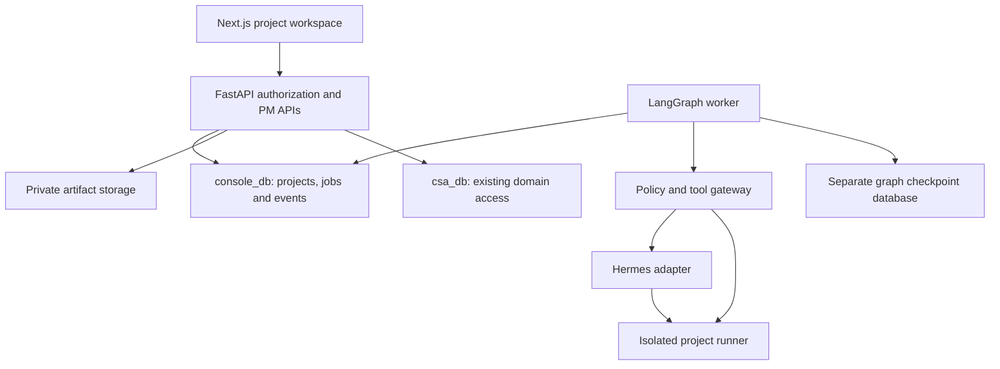
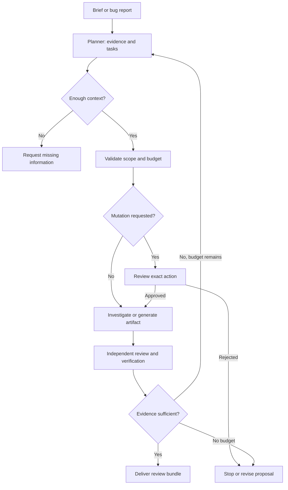

# Architecture and product design

## 1. What the feature should do

An administrator can create an internal project or select a real client and extend an existing channel-linked project. Each project has an overview, milestones, task board, notes, diagrams, architecture, repositories, AI activity and an optional terminal. The AI proposes a plan from a brief and project evidence; it can investigate a bug, propose changes, execute an approved coding task in an isolated workspace, run verification, and prepare a review bundle.

Example: create “Client A booking assistant”, enter goals and constraints, link a repository, generate milestones and an ERD, review proposed tasks, assign an investigator to a failing test, inspect a reproducible bug report, approve a patch task, and review the resulting diff and test output. Implementation work is distinguished from deployment; no successful patch implies a production release.

## 2. Existing facts and compatibility

The supplied state describes Next.js 16/React 19/TypeScript/Tailwind v4, FastAPI, app-owned PostgreSQL `console_db`, live domain PostgreSQL `csa_db`, SSH/Tailscale connectivity, cookie authentication and privileged auditing. This is documentary evidence, not a checked repository inventory.

- `app.projects` already represents tenant projects and owns channel bindings. Extend it; keep IDs, status values `setup/active/archived`, channels and current endpoints compatible.
- Keep PM state in `console_db`, under `app.pm_*` tables. Do not create PM tables in `csa_db` or expand the existing limited domain write grants.
- Existing domain customer IDs are soft references across DBs; verify their type and validate them through `domain_engine`. There is no cross-database foreign key.
- Retain current authentication, backend guards, CSRF origin enforcement, no-store responses and sanitizer. Extend these for SSE and WebSockets explicitly.
- Existing customer-service agent pages and the new project-agent library have distinct purposes and routes.
- Reconfirm the current `55 tests passing` claim in the actual checkout; do not record it as a new test result.

## 3. Control plane and execution plane

The runner hosts approved project clones/worktrees and tools. The application host is not the coding agent's unrestricted execution target. LangGraph owns delegation, checkpoints, approvals, cancellation and aggregate budgets. Hermes owns only its assigned bounded job. Avoid two autonomous supervisors independently expanding the same task.

### Initial deployment footprint

Use existing console PostgreSQL for app records and a dedicated logical PostgreSQL database/role for graph checkpoints on the same PostgreSQL service if practical. Checkpoint-library tables are library-managed; use its supported setup procedure, not invented ORM mappings. A separate DB limits accidental search_path exposure. A small separately supervised Python worker polls app-owned durable jobs with leases. No Redis, Kubernetes or vector service is needed for the first planner. Add a broker only if measured throughput justifies it.

Each worker is restartable and stateless apart from database checkpoints and approved artifact storage. FastAPI never relies on its own BackgroundTasks for long agent jobs. Docker services on the same network use service DNS and container ports, not the developer laptop's forwarded localhost ports. Keep internal services private; expose the console through the existing HTTPS ingress. Tailscale is an optional private transport between the VPS, homeserver and a local connector.

## 4. Project identity and visibility

Proposed additional project scope: `client` or `internal`. A client project has a valid domain `client_id`; an internal project has no `client_id`. An admin creating a project for a client still creates a client-scoped project. Creator identity is not tenant ownership.

Before making `client_id` nullable, discover its actual constraints, unique keys, enum strategy and existing joins. Add scope with a backfill of `client`, then a constraint expressing `(scope='client' AND client_id IS NOT NULL) OR (scope='internal' AND client_id IS NULL)`. Keep tenant slug uniqueness for client projects and add a separate uniqueness constraint for internal slugs. Do not use a fictitious client row to represent internal projects. Every portal path retains `client_id = current_user.client_id AND scope='client'` checks.

Default all new notes, agent messages and technical artifacts to `admin_only`. Share an explicitly selected revision as `client_visible`; internal projects can never be published to a client. Client visibility is not equivalent to membership or tool permission. Future per-project memberships can refine which members of a tenant see each client project.

## 5. Agent definitions, identities and memory

Global reusable definitions include a display name, role, model policy reference, capabilities, versioned profile, SOUL/identity text and approved skill definitions. Initial roles: Planner, Architect, Investigator, Implementer, Reviewer, QA. These need not be six running processes. Run only the role needed; one model can serve several roles.

A project assignment instantiates a definition with a project-specific policy and memory namespace. Effective tool permission is the intersection of definition capabilities, project policy, run approval and runner limits. Persona text and learned memory cannot grant tools.

| Layer | Example | Reuse |
|---|---|---|
| Global definition | Architect instructions and generic AWS skill | Versioned across projects |
| Project memory | Client A decisions, requirements and conventions | Only this project |
| Tenant memory | Approved terminology shared by that client's projects | Explicit tenant opt-in |
| Run/checkpoint state | Current task, observations and pending approval | One run/thread |
| Personal assistant state | Existing Hermes user preferences and history | Outside the console PM system |

Store project facts with source revision/path, confidence, owner, timestamps and expiry. Scope retrieval by authorization first, then similarity or keyword relevance. Begin with PostgreSQL full-text search and backlinks; introduce pgvector only if retrieval evaluation shows a useful improvement. Do not feed entire repositories or all notes into every run. Assemble bounded context from project brief, relevant notes, selected file spans, task evidence and summaries.

Treat SOUL.md as identity/tone, PROFILE.md as role configuration, approved skills as procedures, and project memory as facts. Repo AGENTS.md and uploaded documents are project guidance/data within policy, never overrides of service permissions. Promote a generic lesson into the global library only after a human reviews and removes customer-specific material.

### Hermes caveats

Assumption: your Hermes is Nous Research Hermes Agent. Verify exact project, version, supported headless interface, output format, memory location, terminal backend and cancellation behavior. An adapter described here is new console code, not a claim of an existing Hermes REST API.

Use a fresh isolated Hermes runtime home for every concurrent project-agent instance, or one persistent home per project/assignment with a single-writer lease. Seed only reviewed identity and generic skills. Do not clone the live personal profile wholesale: it may include private memory, credentials and sessions. Hermes profile separation controls agent state; filesystem and credential isolation still require a separate runner/container boundary. Protect the personal agent during the server move.

## 6. Bounded multi-agent execution

Agent messages are structured work items: proposal, question, evidence, handoff, review and final result. The AI workroom displays these public summaries and tool results, not hidden chain-of-thought. Every message links to its project, task, run and evidence. Use a dependency-aware queue and explicit task ownership rather than endless group chat.

Start with two concurrent read-only subtasks per project, one writer per checkout, two total active runs on the homeserver, maximum two repair cycles per task, a 15-minute wall-time cap for initial jobs and an admin-set token/cost budget. These are provisional conservative defaults. Budget applies across subagents and Hermes's nested calls; an independent model call must not escape accounting. Unknown model cost is labeled unknown, and token/wall-time caps still apply.

## 7. Terminal: choose what “local” means

A browser cannot attach directly to an arbitrary local OS shell. Implement an xterm.js viewer/input client and a controlled PTY service.

| Mode | Shell runs on | Best use | Rollout |
|---|---|---|---|
| Project runner | Dedicated isolated host/VM/container worker | Hosted console and AI coding | Phase 06 default |
| Developer companion | Your laptop via paired connector | Actually use laptop files/tools | Later option |
| Host maintenance | Application/homeserver OS | Infrastructure administration | Separate operations tool, outside PM MVP |

One project can have several terminal tabs, each bound to a server-selected workspace ID, PTY ID and owner. An execution run uses its own worktree to avoid editing the interactive human checkout. Reconnection restores scrollback within a cap; it does not replay keystrokes. Tabs can detach from a running PTY and expire after idle timeout. Terminal access is admin-only initially.

For laptop mode build a separate signed/pairable companion with explicit workspace registration, consent and private connectivity. A page must not silently discover/open a local shell. The initial remote project terminal satisfies dedicated per-project windows; it does not claim to control your laptop.

## 8. Diagram and architecture scope

“Every diagram” is an extensibility goal with a supported-type catalog, not a truthful promise of universal coverage on day one. Mermaid is the initial renderer for common textual diagrams. PlantUML expands UML coverage. A structured graph canvas provides editable application/cloud layouts; local pinned AWS assets supply recognizable service icons.

| Category | Initial implementation | Expansion |
|---|---|---|
| Sequence, class, ERD, state, flow/activity approximation | Mermaid types supported by installed version | PlantUML alternatives |
| Use case, object, component, deployment, timing | PlantUML plugin | More UML semantics/notation checks |
| UML communication, package and composite structure | Explicit templates/validated conventions | Capability registry entries and fixture coverage |
| C4 context, containers and components | Structured canvas or pinned supported renderer | Dynamic/deployment viewpoints |
| DFD, BPMN, domain modeling | Clearly labeled later plugins/templates | Dedicated notation-aware renderer where required |
| Application architecture | Typed component/dependency canvas plus ADR | Compare proposed vs observed system |
| AWS architecture | Typed graph with account/region/VPC/AZ boundaries and local service icons | Read-only inventory import and IaC proposals |

Generation produces source, a rendered preview, assumptions, evidence and validation status. Architecture generation asks about traffic, availability, data sensitivity, region and budget before prescribing infrastructure. Document account, region, public/private boundaries, security groups, IAM roles, failure modes and recovery choices. Cost estimates carry date, region and assumptions; do not invent exact AWS prices. Architecture diagrams do not deploy AWS resources. Terraform/CDK drafts are separate review artifacts, with planning inside a configured sandbox and no automatic apply.

## 9. Suggested enhancements

- Versioned project templates for your three AI solutions: reusable milestones, tests and approved agent packs, with client-specific configuration kept scoped.
- A requirements-to-test traceability view linking brief → task → diagram/ADR → patch → evidence.
- Explicit “current system” vs “proposed system” diagrams, with drift/staleness badges after repository changes.
- One-click client-safe progress reports assembled from shared milestones and accepted artifacts.
- Read-only incident/log import with source timestamps; attach production evidence without giving the agent production credentials.
- Change requests, risk register, decision log and milestone acceptance criteria.
- A replay/evaluation dataset of real anonymized project tasks to compare models, prompts and runtimes.
- Per-project cost and execution limits, queue visibility and support handover bundles.
- Outage/degraded mode: manual boards/notes work even when the AI or Hermes service is unavailable.

Defer billing, unrestricted automatic cloud changes, many parallel agents, complex collaborative editing and a new vector database until core use is measured.
