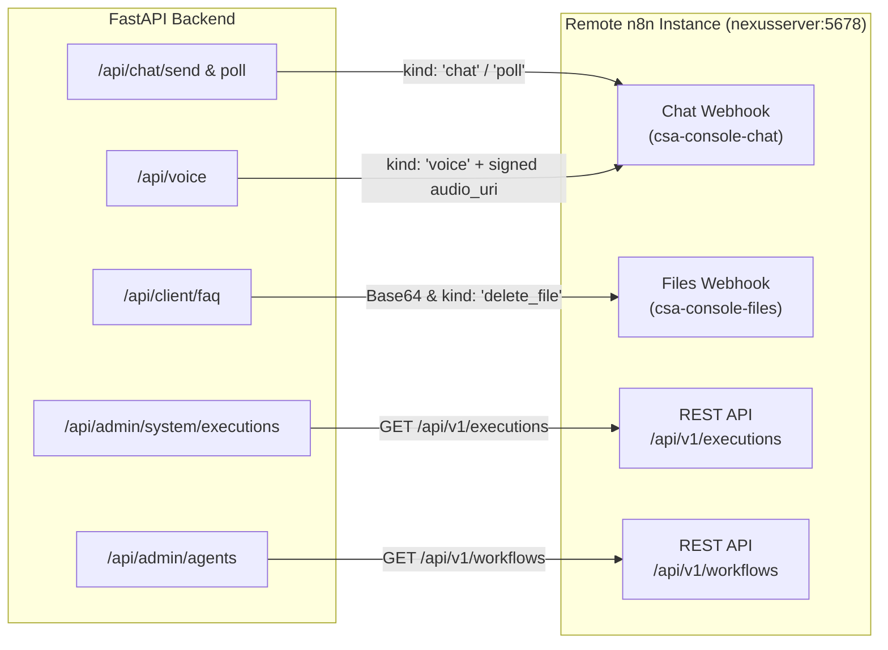

# Repository Findings & Baseline Discovery (Phase 00)

**Date**: 12 October 2026  
**Status**: Verified & Documented (Local Phase 00 Complete)  
**Authority**: Grounded in active codebase audit of `csa-console` and `STATE.md`

---

## 1. Codebase Architecture, Roots & Dependency Tooling

### 1.1 Directory Roots & Ecosystem
- **API Root**: `/Users/dansan04/Documents/WebConsoleCSA/csa-console/api`
  - Runtime: Python 3.14.7 managed via `uv`
  - Core Framework: FastAPI >= 0.115, Uvicorn >= 0.30, Pydantic >= 2.8, Pydantic-Settings >= 2.4
  - Database Driver: `psycopg[binary] >= 3.2`, `sqlalchemy >= 2.0`
  - Security: `argon2-cffi >= 23.1`, `email-validator >= 2.2`
  - HTTP Clients: `httpx >= 0.28.1`
- **Web Root**: `/Users/dansan04/Documents/WebConsoleCSA/csa-console/web`
  - Framework: Next.js 16.3.8 (App Router), React 19.2.8, TypeScript 5
  - Styling: Tailwind CSS v4 (`@tailwindcss/postcss: ^4`, `@theme` token definitions in `app/globals.css`)
  - Icons & UI: `lucide-react: ^1.52.0`, `dompurify: ^3.4.16`, `marked: ^18.1.0`, `recharts: ^3.10.1`
  - Missing Packages (Planned for Later PM Phases): `@xyflow/react` (architecture canvas), `@xterm/xterm` / `@xterm/addon-fit` (terminal), `mermaid` (diagrams) are **not currently installed** in `package.json`.

### 1.2 ORM and Migration Tooling
- **Current Pattern**:
  - The repository does **not** use Alembic or declarative SQLAlchemy ORM models (`Base = declarative_base()`).
  - Schema changes are managed as raw SQL migration scripts located in `csa-console/api/sql/`:
    - `0001_app_schema.sql`: Base tables (`app.users`, `app.sessions`, `app.invites`, `app.audit_log`, `app.login_attempts`).
    - `0002_clients_projects.sql`: Client roles, `app.projects`, `app.project_channels`.
  - Database interactions in application code use raw SQL executed via SQLAlchemy connection pools: `conn.execute(text("..."), params)`.
  - Migration Strategy for PM: Continue using sequential additive SQL scripts (e.g. `0003_pm_project_scope.sql`) executed during database setup. Ad hoc startup DDL must never be used.

### 1.3 Service Startup, Process Count & Port Topology
- **FastAPI Core (`csa-console/api/app/main.py`)**:
  - Started via `uv run uvicorn app.main:app --host 127.0.0.1 --port 8100 --reload` (port 8100).
  - Single-process execution model.
  - **Embedded Voice Listener**: In `app/main.py`, the application `lifespan` manager spins up an asynchronous background task running a second Uvicorn server (`voice_app` from `app.modules.voice.server`) binding to `0.0.0.0:8090`.
  - **Collision Risk**: If Uvicorn is ever started with `--workers > 1`, worker processes will simultaneously attempt to bind `0.0.0.0:8090`, causing immediate startup failure.
- **Next.js Web (`csa-console/web`)**:
  - Started via `PORT=3001 npm run dev` (configured on port 3001 to prevent collisions with macOS AirPlay or default port 3000).
  - Reverse proxy to API configured in `next.config.ts` rewrites `/api/:path*` to `http://127.0.0.1:8100/api/:path*`.
- **Database Topology**:
  - Local App Database (`console_db`): Docker PostgreSQL 16 on `127.0.0.1:5440` (schema `app`).
  - Remote Domain Database (`csa_db`): Forwarded via SSH tunnel (`make tunnel`) to `127.0.0.1:5433` (read-only pool `domain_engine`, restricted write pool `domain_write_engine`).
  - Remote n8n API: Forwarded via SSH tunnel to `127.0.0.1:5679` (remote port 5678).
  - Remote Coordinator (`csa_mcp`): Forwarded via SSH tunnel to `127.0.0.1:8001`.

### 1.4 API Client Architecture
- Web client located in `csa-console/web/lib/api.ts`.
- Uses native `fetch` with `credentials: "same-origin"`, `cache: "no-store"`, and JSON header defaults.
- Handles HTTP 401 by redirecting to `/login`.
- Exports `api<T>()` and `post<T>()`.
- **Finding**: No helpers exist yet for `PUT`, `PATCH`, `DELETE`, or streaming `SSE`. New PM modules will require extending `api.ts` or providing a typed PM client.

### 1.5 Repository AGENTS.md
- **Finding**: Verified that **no `AGENTS.md` file exists** in the repository root or subdirectories. Project-management agent definitions will reside in `app.pm_agent_definitions` in `console_db`.

---

## 2. Project Readers, Writers & Internal Project Compatibility

### 2.1 Inventory of Project Data Access Callers

| Component | Path | Methods / Operations | Notes |
| :--- | :--- | :--- | :--- |
| **Client Service** | `api/app/modules/client/service.py` | `list_projects`, `get_project`, `create_project`, `list_channels`, `add_channel`, `remove_channel`, `bindings`, `available_webhooks` | Core data access layer. Enforces `_cid(client_id)` check. |
| **Client Router** | `api/app/modules/client/router.py` | `GET /api/client/projects`, `POST /api/client/projects`, `GET /api/client/projects/{id}`, `PATCH /api/client/projects/{id}`, `POST/DELETE channels` | Tenant self-service. Scopes all queries by `user.client_id`. |
| **Admin Clients Router** | `api/app/modules/admin_clients/router.py` | `GET /api/admin/clients`, `GET /api/admin/clients/{id}/projects`, `POST /api/admin/clients/{id}/projects` | Admin onboarding. Summarizes project counts per client. |
| **Monitoring & Activity** | `api/app/modules/client/router.py` | `GET /api/client/agents?project_id=...`, `GET /api/client/activity?project_id=...` | Filters agent telemetry and activity streams by project channel bindings via `_scope()`. |
| **Audit Logging** | `api/app/core/audit.py` | `project.created`, `project.updated`, `project.channel_added`, `project.channel_removed` | Writes to `app.audit_log` with actor, target, IP, and JSONB details. |

### 2.2 Compatibility Effects of Introducing Internal Projects
1. **The `_cid()` Strictness Issue**:
   - `client/service.py` defines:
     ```python
     def _cid(client_id: str | None) -> str:
         if not client_id:
             raise RuntimeError("tenant scope missing")
         return str(uuid.UUID(str(client_id)))
     ```
   - Any attempt to use `client/service.py` functions for internal projects (`client_id = None`) will trigger a `RuntimeError`.
   - **Resolution for Phase 01**: Do not alter `client/service.py` in ways that degrade tenant isolation. Create a dedicated `app/modules/pm/` service for administrative project hub access that supports both client-scoped and internal projects.
2. **Slug Uniqueness Constraint**:
   - In `0002_clients_projects.sql`:
     ```sql
     CREATE UNIQUE INDEX IF NOT EXISTS projects_client_slug_uq ON app.projects (client_id, slug);
     ```
   - In PostgreSQL, standard unique indexes treat `NULL` values as distinct, meaning multiple internal projects could share the exact same slug unless an explicit constraint is added.
   - **Resolution**: Introduce a partial unique index:
     ```sql
     CREATE UNIQUE INDEX IF NOT EXISTS projects_internal_slug_uq ON app.projects (slug) WHERE scope = 'internal';
     ```
3. **Tenant Metric Leaks**:
   - `GET /api/admin/clients` executes:
     ```sql
     SELECT client_id::text, count(*) FROM app.projects GROUP BY 1
     ```
   - Internal projects (`client_id IS NULL`) would produce a `NULL` key in Python dictionaries, but must be explicitly filtered out (`WHERE client_id IS NOT NULL`) so they never count toward any client.
4. **Portal Query Isolation**:
   - Every portal endpoint must continue to enforce `client_id = current_user.client_id AND scope = 'client'`. Internal projects must never be accessible or visible in `/portal/*`.

---

## 3. Data Models, Constraints & Cross-Database Soft References

### 3.1 `app.projects` Table Specification
- `id`: `UUID PRIMARY KEY DEFAULT gen_random_uuid()`
- `client_id`: `UUID NOT NULL` (Soft reference to `csa_db.clients.id`)
- `name`: `TEXT NOT NULL CHECK (length(btrim(name)) between 1 and 80)`
- `slug`: `TEXT NOT NULL`
- `description`: `TEXT NOT NULL DEFAULT ''`
- `status`: `TEXT NOT NULL DEFAULT 'setup' CHECK (status IN ('setup', 'active', 'archived'))`
- `created_by`: `UUID REFERENCES app.users(id)`
- `created_at`: `TIMESTAMPTZ NOT NULL DEFAULT now()`
- `updated_at`: `TIMESTAMPTZ NOT NULL DEFAULT now()`

### 3.2 Status and Deletion Semantics
- **No Hard Deletion**: There is no `DELETE` endpoint for projects in either admin or portal modules.
- **Archiving**: Projects can be updated to `status = 'archived'` via `PATCH /api/client/projects/{project_id}`.
- **Channel Cleanup**: When a project is archived, its channel bindings are automatically purged:
  ```python
  if body.status == "archived":
      conn.execute(text("""delete from app.project_channels
          where project_id = cast(:p as uuid) and client_id = cast(:c as uuid)"""), params)
  ```
  This frees up channel bindings (e.g. webhook public IDs, Telegram chat IDs) for other projects.
- **Task Lifecycles vs Project Status**: Task states (`backlog`, `ready`, `in_progress`, `review`, `done`, `cancelled`) are completely distinct and must not overwrite or overload the project's high-level `status`.

### 3.3 Why Cross-Database Client Validation is a Soft Reference
- `console_db` (local Docker container on port 5440) and `csa_db` (production database on nexusserver, forwarded to 5433) are physically distinct PostgreSQL databases.
- PostgreSQL cannot enforce foreign key constraints across separate database instances without Foreign Data Wrappers (FDW).
- Therefore, `client_id` in `console_db.app.projects` is a soft reference.
- Validation is performed in application logic via `_client_exists(client_id)`:
  ```python
  def _client_exists(client_id: str) -> str:
      cid = service.as_uuid(client_id)
      with domain_engine.connect() as conn:
          if not conn.execute(text("select 1 from clients where id = cast(:c as uuid)"), {"c": cid}).first():
              raise HTTPException(404, "Client not found")
      return cid
  ```

---

## 4. Inventory of n8n Dependencies & Protocol Contracts

The application currently integrates with n8n across four functional pillars:



### 4.1 Chat Turn Ingress & Polling (`app/modules/chat/router.py`)
- **Chat Webhook (`CHAT_WEBHOOK_URL` / `N8N_CHAT_WEBHOOK_URL`)**:
  - Outgoing HTTP POST dispatched by `post_n8n()`.
  - Headers:
    - `X-CSA-Chat-Trace-ID`: UUID generated per turn.
    - Ingress secret header: `settings.n8n_ingress_header_name` (default `X-CSA-Chat-Secret`).
  - Envelope Schema:
    - Text turn: `{ kind: "chat", trace_id, idempotency_key, message, client_id, contact_id, channel, project_id, files: [...] }`
    - Polling turn: `{ kind: "poll", trace_id, idempotency_key, client_id, contact_id }`
  - Idempotency & Turn Recovery: If the turn times out (> 100s), the API returns HTTP 504 with `{ status: "pending", trace_id, idempotency_key }`. The frontend polls using `GET /api/chat/poll` every 2 seconds until status is `done`.

### 4.2 Document Management Webhook (`app/modules/client/router.py`)
- **Files Webhook (`FILES_WEBHOOK_URL` / `N8N_FILES_WEBHOOK_URL`)**:
  - Ingestion: Uploads Base64 encoded payload with schema 2.0:
    ```json
    {
      "client_id": "<uuid>",
      "uploaded_by": "<uuid>",
      "files": [{ "filename": "faq.pdf", "stored_as": "<uuid>.pdf", "mime_type": "application/pdf", "data_base64": "..." }]
    }
    ```
  - Two-Phase Deletion:
    ```json
    {
      "kind": "delete_file",
      "file": { "stored_as": "<uuid>.pdf", "folder": "<client_id>" }
    }
    ```
    Deletion requires upstream HTTP 200 `{ ok: true }` confirmation before local record and disk file are purged.

### 4.3 Voice Dispatch (`app/modules/voice/router.py`)
- Transmits a signed URL over Tailscale to the chat webhook:
  ```json
  {
    "kind": "voice",
    "trace_id": "<uuid>",
    "idempotency_key": "<uuid>",
    "audio_uri": "http://<tailscale-ip>:8090/internal/voice/<uuid>.webm?exp=1760000000&sig=..."
  }
  ```
  n8n downloads audio from the local voice listener and coordinates transcription.

### 4.4 Health and Telemetry Probes (`app/modules/agents/n8n.py`)
- Polls n8n REST endpoints:
  - `GET /api/v1/workflows`: Maps workflow IDs to active state. Feeds `workflow_active` flag into `health_state()`.
  - `GET /api/v1/executions`: Retrieves run history, calculates duration, and builds browser deep-links using `N8N_PUBLIC_URL`.
  - Cached for 5 seconds in memory to mitigate API request volume.

---

## 5. Security Architecture, Ingress & Transport Layer

### 5.1 Cookie Attributes & Session Security
- Cookie Name: `csa_session`
- Attributes set in `app/core/sessions.py`:
  - `HttpOnly`: `True`
  - `SameSite`: `lax`
  - `Secure`: Set from `settings.cookie_secure` (defaults to `False` in local HTTP dev, must be `True` in production HTTPS)
  - `Path`: `/`
  - `Max-Age`: 14 days (1,209,600 seconds)
- Sessions stored in `app.sessions` with SHA-256 token hash, IP tracking, and user agent.
- Guards: `require_admin`, `require_client`, `require_client_owner`.

### 5.2 CSRF & Origin Validation
- Implemented as HTTP middleware in `app/main.py`:
  ```python
  @app.middleware("http")
  async def origin_check(request: Request, call_next):
      if request.method not in ("GET", "HEAD", "OPTIONS"):
          origin = request.headers.get("origin")
          if origin and origin != _allowed_origin:
              return JSONResponse({"detail": "Bad origin"}, status_code=403)
      return await call_next(request)
  ```
- Validates the `Origin` header against `CONSOLE_ORIGIN`.

### 5.3 WebSocket and SSE Pass-Through Analysis
- **Current Next.js Ingress**:
  - `csa-console/web/next.config.ts` uses Next.js rewrites:
    ```typescript
    async rewrites() {
      return [{ source: "/api/:path*", destination: "http://127.0.0.1:8100/api/:path*" }];
    }
    ```
- **WebSocket (WS) Compatibility**:
  - **Next.js HTTP rewrites do NOT proxy WebSocket upgrade requests.** WebSockets sent to `/api/...` through port 3001 will fail to complete the HTTP 101 Switching Protocols handshake.
  - Furthermore, FastAPI HTTP middlewares (like `origin_check`) do not run on WebSocket connections.
  - **Implication for Phase 06 (Project Terminal)**: The terminal WebSocket server must either:
    1. Connect directly to a dedicated backend port (e.g. `8100` or a dedicated PTY daemon) bypassing Next.js rewrites, or
    2. Run behind a production reverse proxy (Nginx/Caddy) that handles WebSocket upgrades.
    3. Authentication must be validated via ticket or query parameter, not relying solely on HTTP header origin middleware.
- **Server-Sent Events (SSE) Compatibility**:
  - SSE uses standard HTTP `GET` with `Content-Type: text/event-stream`.
  - Next.js rewrites can pass SSE streams provided `Cache-Control: no-cache` is set and response buffering is disabled.

---

## 6. Baseline Verification & Actual Test Results

Actual command execution was performed locally on the checkout.

### 6.1 Pytest Suite Execution
- Command: `uv run pytest` inside `csa-console/api`
- Environment: Darwin (macOS), Python 3.14.7, pytest 9.1.1
- **Result**: **55 passed, 1 warning in 0.99s**
  - `tests/test_agent_toggle.py`: 14 passed
  - `tests/test_chat_delete.py`: 9 passed
  - `tests/test_client.py`: 17 passed
  - `tests/test_core.py`: 4 passed
  - `tests/test_voice.py`: 11 passed
  - Warning: 1 `StarletteDeprecationWarning` regarding `httpx` with `starlette.testclient`.
  - Zero live write tests were run against `csa_db`.

### 6.2 Frontend Linting
- Command: `npm run lint` inside `csa-console/web`
- Environment: ESLint 9, Next.js 16.3.8
- **Result**: **0 errors, 4 warnings**
  - 2 warnings: Relative navigation with `location.href` in `AppShell.tsx` and `api.ts`.
  - 2 warnings: Unused variables in `ChatComposer.tsx`.

### 6.3 Backend Linting
- Command: `uv run ruff check .` inside `csa-console/api`
- **Result**: **98 errors found**
  - Predominant issue: `B008` (Do not perform function call `Depends` in argument defaults). This is standard FastAPI idiomatic syntax, but `pyproject.toml` lacks `[tool.ruff.lint]` ignore configuration for `["B008"]`.
  - Minor issues: Unused imports and unsorted blocks in root scratch scripts (`query_n8n.py`, `test_config.py`, `test_uuid.py`).

---

## 7. LangGraph and Hermes Diagnostics

### 7.1 LangGraph Local Status
- Not installed in `csa-console/api`.
- `pyproject.toml` does not list `langgraph`, `langgraph-checkpoint-postgres`, or `langchain-core`.
- In Phase 04, these dependencies must be pinned and added to `pyproject.toml` and locked with `uv lock`.

### 7.2 Hermes Local Status
- Not installed on local developer machine.
- Diagnostic script `checks/inspect-server.sh` is prepared for operator execution on the remote homeserver/VPS to verify Hermes version, headless API availability, and profile configuration.

---

## 8. Proposed Module Boundaries & Minimal Phase 01 Diff

### 8.1 Proposed Architecture Boundaries
- **Backend**:
  - `csa-console/api/app/modules/pm/`: Administrative project management hub (projects, tasks, milestones, notes, artifacts, permissions).
  - `csa-console/api/app/modules/pm_ai/`: LangGraph runner, run events, proposals, approvals.
  - `csa-console/api/app/services/pm_tools/`: Sandboxed tool execution handlers.
- **Frontend**:
  - `csa-console/web/app/(admin)/projects/`: Project list and detail views (`/projects`, `/projects/[id]`).
  - `csa-console/web/app/(admin)/project-agents/`: Global PM agent definition library (`/project-agents`).
  - Reuse `components/ui/kit.tsx` primitives and AppShell sidebar.

### 8.2 Proposed Minimal Schema Changes (Phase 01 Preview)
```sql
-- Migration: 0003_pm_project_scope.sql
-- 1. Add scope column defaulting to 'client' for all pre-existing projects
ALTER TABLE app.projects ADD COLUMN IF NOT EXISTS scope text NOT NULL DEFAULT 'client';

-- 2. Allow nullable client_id for internal projects
ALTER TABLE app.projects ALTER COLUMN client_id DROP NOT NULL;

-- 3. Add scope check constraint ensuring exact alignment
ALTER TABLE app.projects DROP CONSTRAINT IF EXISTS projects_scope_check;
ALTER TABLE app.projects ADD CONSTRAINT projects_scope_check
  CHECK ((scope = 'client' AND client_id IS NOT NULL) OR (scope = 'internal' AND client_id IS NULL));

-- 4. Add partial unique index for internal slugs
CREATE UNIQUE INDEX IF NOT EXISTS projects_internal_slug_uq
  ON app.projects (slug) WHERE scope = 'internal';
```

---

## 9. Compatibility Test List for Phase 01
1. **Migration Stability**: Verify that applying the migration leaves existing `app.projects` rows intact with `scope = 'client'` and valid UUIDs.
2. **Existing Portal Visibility**: Ensure `/api/client/projects` continues returning tenant projects without 500 errors.
3. **Tenant Scope Rejection**: Verify that calling tenant endpoint `POST /api/client/projects` with an internal project payload is rejected.
4. **Client Counts Protection**: Verify `GET /api/admin/clients` returns accurate project counts excluding internal projects.
5. **Slug Collision Independence**: Verify an internal project and a client project can share the same slug without triggering duplicate key violations.
6. **Feature Flag Isolation**: Verify `PM_ENABLED=False` cleanly disables PM routes with HTTP 404 or 503.
