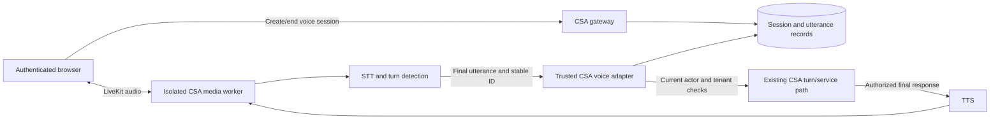

# Interactive voice implementation plan — 2026-10-24

Status: Phase 1 and Phase 2 are implemented in the working tree as of 2026-10-25
(see the [recovery audit](2026-10-24-voice-recovery-audit.md)); Phase 3 is next.
This document does not activate providers, migrate a persistent database, or
start services.

## Objective and verified baseline

Deliver authenticated staff-browser conversation: start once, speak naturally,
receive spoken replies, interrupt an answer, and continue with the same authorized
conversation. Display transcripts and provide mute, Stop and text fallback.
Initially support English and Bahasa Melayu; evaluate Manglish/code switching
before claiming it is supported.

The saved CSA source already provides recorded transcription, a sequential
browser voice loop, and Telegram voice-note transcription. Its remaining defects
and validation evidence are in the [recovery audit](2026-10-24-voice-recovery-audit.md).
The current loop switches off the microphone before thinking or speaking, so it
cannot support interruption by speech.

Legacy source inspected read-only:
`/home/amsyrzmi/stacks/csa-livekit/livekit-voice-agent/src/agent.py`.
It connects to a LiveKit room and constructs Groq Whisper STT. Its own comment
leaves microphone-track attachment for a future calling app; it has no complete
STT-to-CSA-to-TTS conversation loop. This is evidence about the source found,
not proof about every historical deployment. Do not assume existing containers
prove interactive acceptance.

Follow [the workspace voice roadmap](../archive/handoffs/2026-10-21-workspace-agents-roadmap.md#voice-ingress-plus-conversational-rendering-not-a-privileged-agent),
[LG03](../langgraph-rebuild/LG03_ingress_gateway_channels.md),
[LG15](../langgraph-rebuild/LG15_console_turnover.md), and `AGENTS.md`.
Current source takes precedence over older descriptions of unimplemented features.

## Target architecture

The gateway owns authentication and session binding. The media worker handles
audio, end-of-turn detection, interruption and playback. Existing CSA services
own domain reads/actions and their permission/confirmation rules. Media code
must not import LangGraph or introduce a second business decision engine.

## Phase 1 — Stabilize the current voice implementation

Status: implemented 2026-10-24; integrated browser regression passed.

1. Give voice and ordinary text send one authoritative pending-turn record:
   request key, transcript, acceptance state and recovery status. After uncertain
   acceptance, retries and switching input modes preserve the same request key.
   Explicitly distinguish rejected work from work whose acceptance is unknown.
2. Bound individual CSRF, upload, status and turn requests. Enforce polling
   deadlines across awaits, with visible errors and same-key recovery.
3. Make Stop release microphone and playback immediately. Explain accepted work
   separately; Stop cannot undo a committed turn or action.
4. Reproduce the browser target crash with browser stderr, console/page errors,
   traces and available resource/crash evidence. Separate harness startup faults
   from application failures; do not hide the failure with longer timeouts or
   repeated retries.
5. Test the actual integrated sandbox, including lost acknowledgements, ordinary
   Send, Stop, recording cancellation and conversation changes.

Exit: one accepted utterance remains one durable turn through uncertainty;
requests terminate predictably; integrated browser acceptance passes. Preserve
the previously failed evidence.

## Phase 2 — Define and implement trusted voice sessions

Status: implemented 2026-10-24 (migration `0440`, `csa/voice/`, sandbox profile only,
disabled by default); synthetic session/revocation/replay tests pass. Provider
selection for STT/TTS (item 5) remains open.

1. Define typed session and utterance contracts, lifecycle, expiration and
   cancellation semantics. Bind each session server-side to a verified user,
   tenant, browser login, conversation and allowed capability profile.
2. Add gateway create/status/end operations, tenant-scoped persistence, audit,
   short-lived room-specific participant tokens and trusted media-worker identity.
   Revalidate authority for every accepted utterance and sensitive operation.
3. Assign stable session/utterance/request IDs. Persist acceptance and results so
   duplicate finals or a worker retry cannot create another business turn.
   Reconnect queries existing acceptance; it must not create a fresh utterance
   identity for uncertain work. Define safe recovery after page reload.
4. Start with the existing sandbox capability profile. Add an explicit staff
   workspace profile through its existing services in Phase 5. Never infer
   permission from speech, room metadata supplied by a browser, or model output.
5. Choose supported STT/TTS provider configuration and an isolated LiveKit target.
   Retain Groq Whisper as the initial STT candidate, using bounded utterance
   chunks where necessary. Do not describe its file-transcription endpoint as
   native streaming STT. Verify language and latency before selecting it for the
   final interactive path. Select server TTS that demonstrates English/Malay
   support; browser-installed voices should not be a requirement for that path.

Exit: synthetic session, tenant, replay, expiry, logout and revocation tests pass;
provider credentials remain server-side. Any new migrations are additive,
parameterized SQL stays under `db/sql/`, and dependencies are exactly pinned
with lockfile updates.

## Phase 3 — Implement one complete live conversational path

1. Add a separate media worker and browser LiveKit connection with explicit
   microphone consent, audio-device errors and observable connection state.
2. Implement microphone audio -> STT -> finalized utterance -> trusted CSA
   turn -> authorized final reply -> TTS -> browser audio.
3. Keep interim transcripts display-only. Use existing coordinator verification
   and domain outcomes before speaking substantive responses; do not speak
   unverified model drafts to reduce apparent latency.
4. Add server TTS and correlate text, spoken audio and durable turn IDs. Render
   listening, processing, speaking, reconnecting and error states accurately.
5. Show readable history, mute/unmute, Stop, playback language and text fallback.
   Make the canonical conversation state available to both voice and text.

Exit: a synthetic user completes multiple consecutive turns with the correct
CSA history, grounded responses and no duplicated submission. Then validate a
real microphone against the isolated development stack under an explicitly
configured development provider setup.

## Phase 4 — Add natural interruption and robust recovery

1. Keep input audio available during playback and detect genuine user
   interruptions while suppressing speaker echo and brief noise/backchannels.
2. On interruption, stop the current speech promptly, mark what was actually
   played, and accept the new utterance without replaying obsolete audio.
   Distinguish the generated response from the portion the user heard.
3. Handle speech overlapping an in-progress answer, silence, long pauses,
   maximum utterance/session duration, provider timeout and microphone loss.
4. Reconnect using persisted session/utterance state. Reject stale participants,
   superseded responses and duplicate final transcripts. End sessions on logout,
   authority revocation, expiry or explicit Stop.

Exit: interruption, false-interruption, overlapping-turn, disconnect/reconnect,
reload, logout and duplicate-final tests pass. LiveKit provides turn detection
and interruption primitives; CSA must still preserve its own durable turn and
action semantics. See [LiveKit turn handling](https://docs.livekit.io/agents/logic/turns/).

## Phase 5 — Connect the interactive path to useful staff capabilities

1. Reuse the existing workspace and HR service paths where those features are
   currently available to the authenticated actor. Check their current source
   before claiming capabilities; the workspace is not an unrestricted assistant.
2. Begin with knowledge answers, navigation guidance and authorized read-only
   operations. Then add the supported draft/preview workflows one at a time.
3. Recheck permissions on each operation. Keep sensitive information on screen
   where appropriate and retain the manual approval path for consequential
   changes. A spoken request does not grant new access or bypass human approval.
4. Provide text/human fallback when transcription is uncertain, a feature is
   unavailable or a provider fails. Avoid promising human follow-up unless the
   existing service records it.

Exit: permitted and forbidden requests behave consistently through manual UI,
text and voice. No action is executed twice after interruption or reconnect.

## Phase 6 — Establish quality and release evidence

1. Test English, Bahasa Melayu, code switching, names, identifiers, accents,
   background noise and speaker echo with synthetic or consented development
   recordings. Treat unsupported languages explicitly.
2. Measure end-of-speech -> final transcript, CSA completion, first audible reply,
   interruption -> audio stop, reconnect time and cost per session separately.
   Proposed initial targets for simple questions are first audio p95 <=3 seconds
   and interruption stop p95 <=300 ms on a documented network/device profile.
   These are provisional targets, not current performance claims. Establish
   baselines and report misses before deciding whether provider/runtime changes
   are needed; do not silently relax targets.
3. Specify raw-audio handling, transcript retention and scheduled cleanup; verify
   expiry is enforced even when the user never opens the application again.
   Ensure logs/telemetry expose IDs and safe error codes rather than audio,
   secrets, sensitive transcripts or provider payloads.
4. Run focused component/API/media tests, integrated browser tests,
   `NO_LOCAL_ENV=1 ENV=ci make lint test`, isolated frontend checks and the real
   reset target through `test_make_reset_only_disposable_container`.
5. After synthetic acceptance, test real media/providers only against the verified
   isolated development stack. Record language, latency, interruption, recovery
   and permissions evidence. Use a feature flag for a bounded pilot and retain
   text fallback and an explicit rollback procedure before wider release.

Exit: all required checks pass on the final source; real interactive acceptance
is recorded; operational limits, provider choice, retention and rollback are clear.

## Scope and implementation slices

Implement in this order, with independently reviewable changes:

1. Current recovery/timeouts/browser stabilization.
2. Session, utterance and media-authority contracts with synthetic providers.
3. Isolated LiveKit worker plus one end-to-end sandbox conversation.
4. Interruption, replay, reload and revocation.
5. Authorized staff capabilities and final quality/rollout evidence.

Use only isolated development databases and synthetic fixtures during development.
Do not attach new code to production, legacy n8n, legacy bot credentials or the
running legacy LiveKit deployment. Development service/provider activation must
have an explicit, verified target. Telegram voice notes remain a supported
separate ingress; Telegram voice calls, telephony and a public customer voice
surface are outside the initial staff-browser slice.
