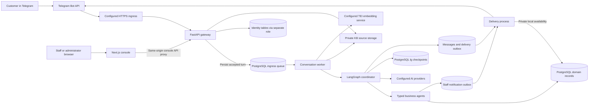
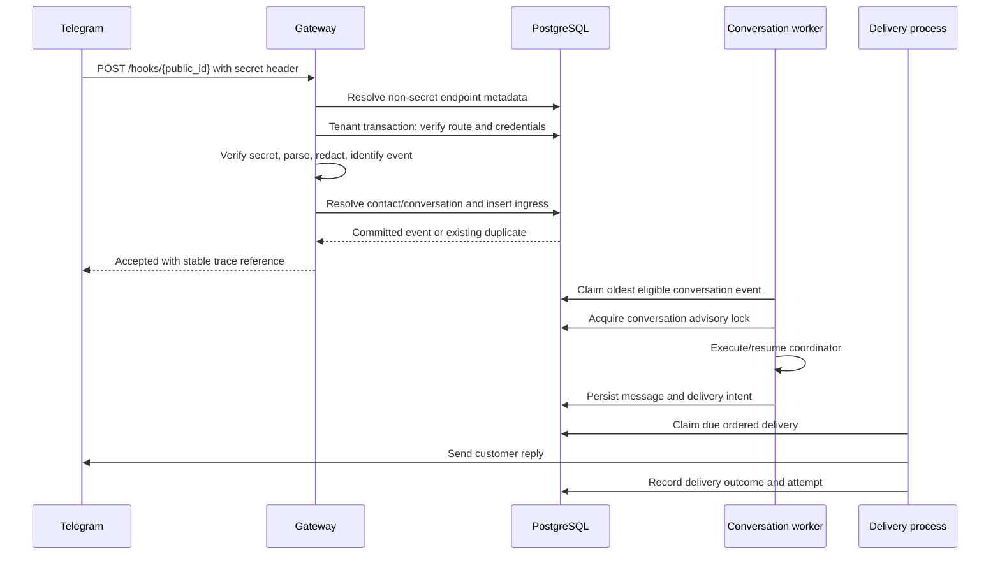
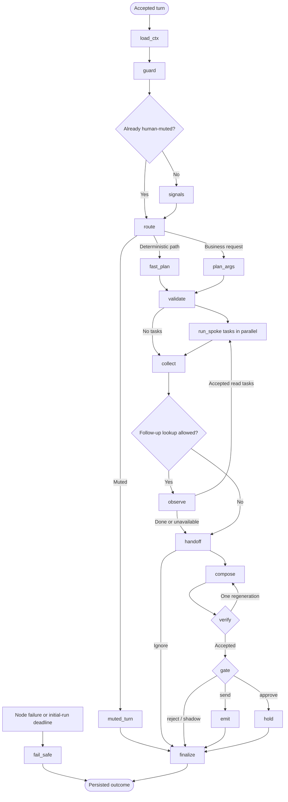
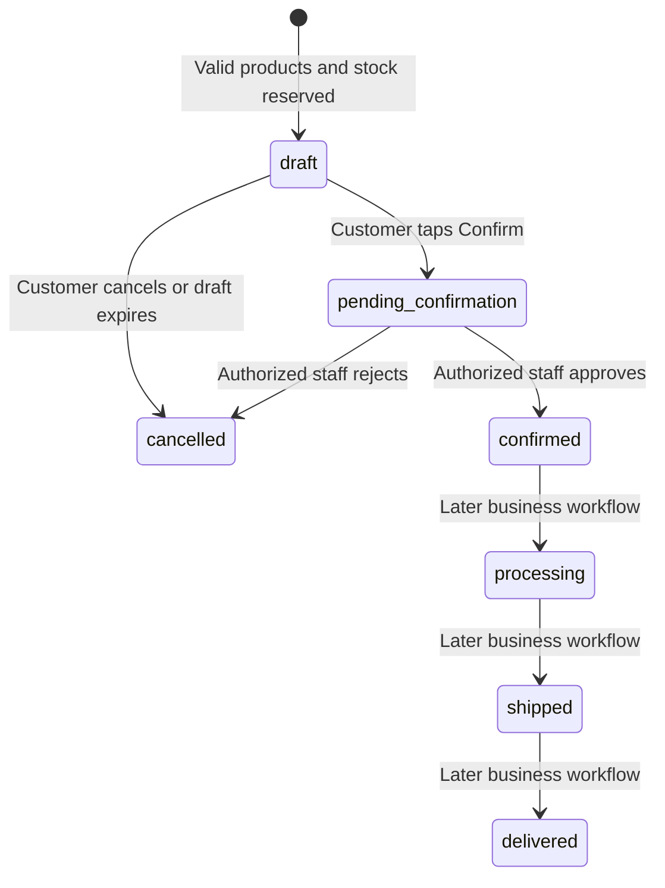
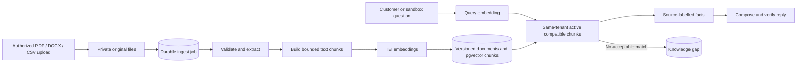
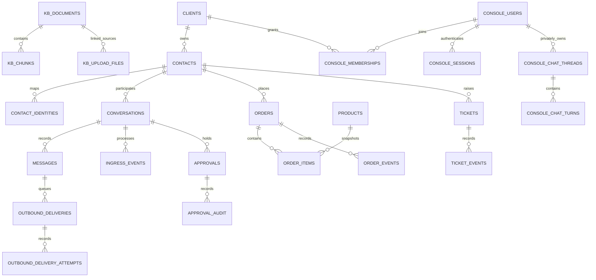

# CSA architecture information

**Architecture snapshot: 17 October 2026, Malaysia time.**

Status/schema reconciliation: 19 October 2026. This long-form architecture snapshot
retains dated descriptions; current continuation is the
[domain/release handoff](handoffs/2026-10-19-domain-release-next-session.md).
Source expects 0360; M6B/M6D remain offline foundations, not live provider/ledger
authority. Repository-only CI/image packaging is implemented; hosting on
`console.fourstacks.my`, promotion and deployment remain disabled/unverified.
See the [release contract](../deploy/RELEASE.md).

**Audience:** clients, delivery stakeholders, technical reviewers, and engineers maintaining CSA.

CSA is a multi-tenant customer-service automation platform. It receives customer messages, interprets requests, retrieves business facts or runs a bounded business operation, applies reply policy, and delivers an answer or brings in a human. A web console gives authorized users access to administration, knowledge management, runtime activity, a private assistant sandbox, and a Telegram customer inbox.

The architecture combines a Python service runtime, a Next.js web console, and PostgreSQL. PostgreSQL stores business records, work queues, approvals, delivery state, and audit records. LangGraph coordinates individual customer turns. External language models interpret and compose; application code and database transactions establish authority and business state.

This document describes the **current repository**, including existing working-tree changes. It distinguishes implemented code, recorded isolated-development validation, integration groundwork, and future plans. It is not a statement that every feature is deployed, that services are currently running, or that the system has production acceptance. No environment-file values, credentials, production data, or private deployment addresses are reproduced here.

## Contents

1. [Purpose and design principles](#1-purpose-and-design-principles)
2. [Implementation and delivery status](#2-implementation-and-delivery-status)
3. [System layout and trust boundaries](#3-system-layout-and-trust-boundaries)
4. [Technology stack](#4-technology-stack)
5. [Processes and responsibilities](#5-processes-and-responsibilities)
6. [Customer-message ingress](#6-customer-message-ingress)
7. [Contracts, identifiers, and conversation context](#7-contracts-identifiers-and-conversation-context)
8. [LangGraph turn coordination](#8-langgraph-turn-coordination)
9. [AI providers, planning, and reply verification](#9-ai-providers-planning-and-reply-verification)
10. [Agent catalogue and execution controls](#10-agent-catalogue-and-execution-controls)
11. [Business-operation lifecycles](#11-business-operation-lifecycles)
12. [Human review, handoff, and ownership](#12-human-review-handoff-and-ownership)
13. [Outbox and delivery guarantees](#13-outbox-and-delivery-guarantees)
14. [Knowledge-base architecture](#14-knowledge-base-architecture)
15. [Console identity and authorization](#15-console-identity-and-authorization)
16. [Console features and HTTP API](#16-console-features-and-http-api)
17. [Frontend architecture](#17-frontend-architecture)
18. [Database architecture and inventory](#18-database-architecture-and-inventory)
19. [Privacy, encryption, and external data flows](#19-privacy-encryption-and-external-data-flows)
20. [Scheduled work and retention](#20-scheduled-work-and-retention)
21. [Reliability and failure handling](#21-reliability-and-failure-handling)
22. [Observability and health](#22-observability-and-health)
23. [Configuration and deployment](#23-configuration-and-deployment)
24. [Development, testing, and recorded evidence](#24-development-testing-and-recorded-evidence)
25. [Migration strategy and future scope](#25-migration-strategy-and-future-scope)
26. [Current limitations and release conditions](#26-current-limitations-and-release-conditions)
27. [Repository map and maintenance](#27-repository-map-and-maintenance)
28. [Glossary](#28-glossary)

## 1. Purpose and design principles

CSA supports several businesses in one platform. Each business is a **tenant**, represented by a `clients` record and a `client_id`. Customers belong to that tenant; staff receive access through verified console memberships or a configured Telegram staff target.

The platform separates five concerns:

| Concern | Responsibility |
|---|---|
| Communication | Verify incoming channel traffic, identify the tenant/customer, and deliver replies through the correct route. |
| Coordination | Decide which path a turn follows and which bounded capabilities it needs. |
| Business operations | Read or change orders, stock, tickets, knowledge, and other supported records. |
| Human control | Review replies, approve supported operations, take over conversations, and resume automation. |
| Administration and evidence | Manage access and capability switches; inspect recorded runs, events, and audit trails. |

The main design principles are:

- **PostgreSQL is the system of record.** A generated answer does not itself establish that an order exists or an action succeeded.
- **Each inbound event is a distinct turn.** The turn has its own trace and graph checkpoint history. Long-term conversation records live in application tables.
- **Application code controls execution.** The model proposes typed tasks; code validates inputs, callback authority, enabled capabilities, and applicable business rules.
- **Work survives process restarts.** Accepted inputs and intended deliveries are persisted instead of remaining only in request memory.
- **Business writes have explicit transaction boundaries.** Related state, events, and supported operation receipts commit together. A complete turn spans multiple transactions.
- **Tenant isolation is enforced in PostgreSQL and the application.** Resource-level and staff/customer permissions remain necessary inside a tenant.
- **Framework dependencies are contained.** Customer-service graph implementation belongs in `csa/graph/`; domain agents do not depend on LangGraph.
- **Per-tenant configuration controls behavior.** Runtime selection, reply policy, brand, timezone, subscriptions, and tenant switches are configuration concerns.
- **Readiness must describe evidence.** A configured provider, a queued request, or a rendered screen is not proof that the external operation works.

Some implementation paths still fall short of these principles. [Section 26](#26-current-limitations-and-release-conditions) records the consequential gaps rather than presenting the design intent as a universal guarantee.

Sources: [master plan](langgraph-rebuild/LG00_master_plan.md), [runtime wiring](../csa/turn/deps.py), [database transactions](../csa/core/tenancy.py).

## 2. Implementation and delivery status

“Implemented” means code is present. “Validated” refers to the stated tests or historical isolated-development checks. “Prepared only” means a request is recorded without external execution. “Deferred” means there is no active supported feature in the adopted application.

| Area | Current implementation | Delivery qualification |
|---|---|---|
| Telegram customer messages | Verified ingress, durable queue, coordinator, callbacks, outbox, delivery retries. | Synthetic Telegram acceptance is recorded; this document makes no new live-availability claim. |
| Orders and local products | Product lookup, order drafts, customer confirmation, staff order approval, stock reservation. | Local database operations; no marketplace inventory synchronization is implied. |
| Support and escalation | Tickets, human handoff, temporary mute, staff alerts, Resume AI. | These do not constitute a complete external helpdesk integration. |
| Knowledge base | Text/file ingestion, retrieval, versions, gaps, originals, deletion fencing, reconciliation. | Production semantic retrieval requires a configured compatible embedding service. Extraction and authorization gaps remain. |
| Console identity/onboarding | Sessions, membership roles, CSRF, manual invitations/resets, tenant creation, audit. | Guided synthetic lifecycle checks are recorded. SSO/MFA and email delivery are outside the implemented slice. |
| Agents/activity console | Capability catalogue, independent switches, readiness metadata, run/event inspection. | Recorded attempts are not complete usage billing or provider-health measurements. |
| Private sandbox assistant | Owner-private text conversations; knowledge and product-information reads. | Customer records and business actions are unavailable. Held sandbox drafts have no release feature. |
| Telegram staff inbox | Staff transcripts, takeover/release, human replies, reply approve/reject/edit. | M5 guarded development rollout and representative role checks are recorded. |
| Business workspace | Staff-only local order/product/stock summaries and pagination. | M6A is an offline foundation; it has not replaced the last approved M5 build. |
| TikTok Shop | Mounted legacy OAuth/webhook scaffolding; separate typed M6B reads, encrypted grant lifecycle and synthetic verifier/completion composition. | New M6B flow is not runtime-registered. Do not expose the legacy callback as its replacement; live eligibility, app/key source, safe callback and console integration remain gated. |
| Inventory M6D | Frozen command/audit contracts, in-memory prototype, identity-only 0360 scaffolding and disposable transaction/role tests. | No authoritative runtime ledger, provider stock writes or synchronization. |
| Shopee and Lazada | Adapter interfaces/placeholders and explicit unavailable webhook/OAuth responses. | No completed operational marketplace integration. |
| Invoice reads | Contact-scoped local status/listing; signature helper/library code. | Console download-link endpoint returns 501; artifact serving and issuance are unavailable. |
| Booking/subscriptions | Local reads and persisted preparation requests. | No Calendar booking, payment, cancellation, or billing execution. |
| Staff email/research/invoice drafting | Typed preparation-service libraries. | No HTTP feature, external fetch/send, issuance, or processing worker. |
| WhatsApp, customer email, public web chat, voice | Contracts, inherited schema, or plans. | No completed active customer-channel implementation in the current turn worker. |
| Projects, PM, terminal, Hermes, workroom, desktop teaching | Retained reference UI/documents and future plans. | Routes are blocked or 404 stubs; those runtimes are not started by the adopted application. |

The M6A **695 passed / one TCP latency failure** and early M6B **41 targeted tests**
are dated evidence, not the latest runs. Current exact M6B and M6D validation, including
focused versus full-suite scope and retained latency failures, is maintained in
[PROGRESS.md](PROGRESS.md). No documentation reconciliation is a new test or deployment
pass.

Current status authority: [PROGRESS.md](PROGRESS.md), [console API](CONSOLE_API.md), [M5 evidence](handoffs/2026-10-17-m5-telegram-inbox.md), [M6 roadmap](handoffs/2026-10-15-console-source-migration-plan.md).

## 3. System layout and trust boundaries

### 3.1 Application topology

The PostgreSQL boxes represent logical responsibilities. They are not a requirement for separate database servers. The active design uses domain and console identity tables in the same database, with separate connection roles, and a separate `lg` schema for checkpoints. Original uploaded files live outside PostgreSQL.

### 3.2 Boundaries that establish authority

| Boundary | Verification or control |
|---|---|
| Telegram → gateway | Public endpoint lookup, enabled route, webhook secret, body/type bounds, event parsing. |
| Browser → gateway | Verified session, exact allowed Origin on mutations, CSRF, role, tenant/resource checks. |
| Gateway → database | Separate identity/domain roles and transaction-local tenant scope. |
| Coordinator → model | Structured requests using redacted message text; output validation and code-owned budgets. |
| Coordinator → agent | Registered implementation, Pydantic input, fresh capability switches, action-specific checks. |
| Customer → business commit | Contact/resource binding and confirmation controls for supported operations. |
| Staff → reply/order decision | Verified console identity or configured Telegram target plus expiring stored actions. |
| Outbox → external channel | Endpoint/trace binding, ownership recheck, durable attempt status. |
| Console upload → filesystem | Tenant directory confinement, server filenames, file validation, bounded streaming. |

The intended edge uses Caddy/cloudflared in existing infrastructure. Their routing and certificates are operational dependencies; this repository does not prove the current public network topology. The application can also run entirely on loopback in isolated development.

### 3.3 State ownership

| State | Owner |
|---|---|
| Customer/contact identity, orders, tickets, stock, messages | PostgreSQL application tables. |
| Accepted inbound work | `ingress_events`. |
| Pending outbound work and attempts | `outbound_deliveries`, `outbound_delivery_attempts`. |
| In-flight orchestration | LangGraph checkpoints in `lg`. |
| Human access | Console users, memberships, sessions, and tokens. |
| Private sandbox ownership | Console chat participant/thread records and application owner checks. |
| Uploaded originals | Private filesystem plus persisted file/batch metadata. |
| Temporary UI state | Browser component memory; it does not grant authority or establish delivery. |

## 4. Technology stack

Versions below are the direct pins in this snapshot. The manifests and lockfiles remain authoritative when dependencies change.

| Layer | Technology | Purpose |
|---|---|---|
| Backend language | Python 3.12 | Async runtime and typed application code. |
| HTTP service | FastAPI `0.143.0`, Uvicorn `0.54.0` | Webhooks, identity, console API, health endpoints. |
| Contracts/settings | Pydantic `2.14.0`, pydantic-settings `2.15.0` | External/persisted contracts and validated configuration. |
| Graph orchestration | LangGraph `1.2.14` | Explicit turn-state transitions and parallel spoke dispatch. |
| Checkpoint persistence | langgraph-checkpoint-postgres `3.1.2` | Durable graph checkpoints. |
| Database access | psycopg `3.3.6`, async APIs/pools | Parameterized SQL, transactions, connection pooling. |
| Database platform | PostgreSQL 16 development/test image | Relational storage, queues, locks, JSONB, RLS. |
| Database extensions | pgvector, PostGIS, pg_trgm, uuid-ossp | Vectors, inherited location features, text-search indexes, UUID generation. |
| HTTP integrations | HTTPX `0.28.1` | Models, Telegram, embeddings, marketplace/telemetry clients. |
| Encryption | cryptography `50.0.2` | AES-256-GCM credential encryption. |
| Document extraction | pypdf `6.20.1`, python-docx `1.2.0`, CSV parsing | PDF/DOCX/CSV ingestion. |
| Logging/serialization | structlog `26.1.0`, orjson `3.13.0` | Structured events and JSON. |
| Tracing | OpenTelemetry API/SDK/exporter `1.45.1` | HTTP spans and optional OTLP export. |
| Frontend | Next.js `16.3.8`, React/React DOM `19.2.8` | Console routing, server identity checks, interactive workspaces. |
| Frontend language/style | TypeScript `5.9.3`, Tailwind `4.3.3`, supplied design tokens | Typed UI and shared visual rules. |
| UI libraries | Lucide, clsx; additional chart/diagram/terminal libraries retained | Supporting UI; a dependency's presence does not mean its feature is active. |
| Packaging | uv `0.9.6` in image/CI; `uv.lock`; frontend npm lockfile | Reproducible dependency resolution. |
| Backend quality | Ruff, Pyright, import-linter, pytest, coverage, testcontainers | Static checks, contract/boundary tests, disposable-DB integration. |

There is no active requirement for Redis, Kafka, Kubernetes, a separate console business API, or a vector database service. PostgreSQL currently supplies queueing and vector storage. Introducing another service would require a measured need and a separate design decision.

Sources: [Python manifest](../pyproject.toml), [frontend manifest](../CSA_WebConsole/csa-console/web/package.json), [database image](../deploy/db.Dockerfile).

## 5. Processes and responsibilities

### 5.1 Gateway

`apps/gateway/main.py` creates the FastAPI application. It:

- Opens the domain pool and, when configured, the separate identity pool.
- Mounts Telegram ingress, console identity/onboarding/domain routes, and marketplace scaffolding.
- Verifies and persists inbound traffic before acknowledging ordinary customer turns.
- Handles supported Telegram staff actions through shared domain services.
- Applies console response headers and sanitized validation-error projections.
- Exposes liveness/readiness and development-only API documentation.

Long customer turns run in the worker. Staff callbacks and some console operations, including inline text ingestion, still perform work within their HTTP request. Therefore the low-latency ingress target applies to the appropriate durable customer-ingress path, not every endpoint.

The domain pool opens eight connections before serving requests. Optional identity pooling has a separate maximum of four. An unavailable configured identity pool fails initialization; absent identity configuration makes human identity unavailable explicitly.

### 5.2 Conversation worker

`apps/worker/main.py` claims ingress, validates envelopes, serializes each conversation, persists inbound messages, and invokes the turn engine. It also starts scheduled jobs, checkpoint retention, and optional KB ingestion.

The process runs **one sequential conversation consumer**. Parallelism exists between agent tasks within a graph, and between separate worker process replicas. Adding a replica does not eliminate PostgreSQL, model-rate, or checkpoint bottlenecks.

`TURN_ENGINE=coordinator` activates the graph. The code default is `echo`, a development/foundation path that persists and echoes messages without the full AI flow. A deployment must explicitly select its intended engine.

### 5.3 Delivery process

`apps/delivery/main.py` drains customer deliveries and staff notifications, reclaims stale leases, and invokes approval expiry. It sends Telegram messages and renders stored UI buttons. For private web sandbox turns, delivery is a local database transition with no external send.

Customer text generation and transport delivery are separate. An available model does not imply a working bot route, and an accepted outbox row does not imply a delivered message.

### 5.4 Optional development Telegram poller

`apps/telegram_poller/main.py` provides a guarded local polling alternative. It deletes the development bot's webhook without discarding queued updates, fetches supported updates, and passes them through the same ingress service. It advances offsets after accepted processing. It is a development tool, not a second production channel implementation or a replacement for deployment review.

### 5.5 Frontend process

The Next.js process serves the adopted console and proxies same-origin `/console/v1/*` requests to the gateway. It neither opens PostgreSQL connections nor starts the copied Python API, PM workers, Hermes, or terminal services.

### 5.6 Maintenance commands

Migrations, initial console-admin bootstrap, checkpoint setup, development Telegram provisioning, API-contract export, and scoped KB ingestion are explicit scripts. Their presence does not mean they run automatically with every application process.

Source entrypoints: [gateway](../apps/gateway/main.py), [worker](../apps/worker/main.py), [delivery](../apps/delivery/main.py), [poller](../apps/telegram_poller/main.py), [scripts](../scripts/).

## 6. Customer-message ingress

### 6.1 Telegram request sequence

The gateway requires JSON and bounds the webhook body to **1,000,000 bytes** while streaming. Unsupported media types, oversized bodies, invalid secrets, malformed updates, disabled endpoints, and missing credentials have explicit failure responses.

### 6.2 Tenant and credential resolution

`public_id` selects an endpoint rather than accepting a caller-provided tenant. The `resolve_endpoint` SQL function is a deliberately narrow `SECURITY DEFINER` lookup that returns routing metadata before tenant scope exists. Its public execution grant is revoked; the application role receives explicit permission.

The gateway then enters a tenant transaction and loads the enabled route/credential record. The Telegram webhook secret and bot token are encrypted. Secret comparison uses constant-time comparison.

Per-endpoint rate limiting uses an **in-process sliding window** and the endpoint's configured requests-per-minute limit. This is not a shared global limiter across gateway replicas.

### 6.3 Normalization, customer identity, and conversations

Telegram text, edited messages, captions, supported attachment metadata, and compact callbacks are normalized. The event key is `telegram:{public_id}:{update_id}`, preventing collisions between endpoints using the same external update number.

Customer messages use private Telegram chats. Staff-group traffic is admitted only through the supported action/edit paths. Parsing attachment metadata does not implement OCR, image understanding, file ingestion, audio transcription, or video processing.

`contact_identities` maps the tenant/channel/external identity to a contact. Contact resolution preserves legacy Telegram mappings and checks concurrent insert conflicts. Conversation resolution checks that the channel thread still belongs to the expected contact; it does not silently adopt another customer's conversation.

### 6.4 Durable deduplication

The gateway computes a canonical JSON SHA-256 payload fingerprint. Equivalent JSON formatting produces the same fingerprint. A replay of the same ingress key returns the existing trace; a different payload under an existing key is logged as a mismatch rather than processed as another turn.

The committed queue row contains the normalized envelope and minimal source metadata. Telegram callbacks may also require a short Bot API acknowledgement and button clearing. UI button removal is convenience; database action state is the authority for reuse prevention.

### 6.5 Queue ordering and recovery

The worker claim query uses `FOR UPDATE SKIP LOCKED`. A later event cannot overtake an earlier received, dispatched, or failed event for the same tenant/channel/thread. After claiming, a dedicated session advisory lock protects that conversation for the duration of processing.

Lock contention requeues work. The worker records explicit failures and retries, with a maximum of five ingress attempts. A periodic reaper handles stale dispatched leases and eligible failed rows. Exhausted work enters `dlq` and requests a staff alert.

### 6.6 Legacy runtime selection

`clients.config.runtime` selects `n8n` or `langgraph`. With `n8n`, ingress can forward the verified update to a configured legacy webhook. In legacy shadow coexistence it also enqueues a CSA evaluation turn. This is a migration mechanism, not an additional always-on business runtime.

Because normal reply suppression, failure replies, and business-side effects are not yet governed by one complete execution-authority boundary, shadow coexistence must not be described as side-effect-free. See [Section 26](#26-current-limitations-and-release-conditions).

Sources: [ingress service](../csa/channels/ingress.py), [Telegram adapter](../csa/channels/telegram.py), [ordered claim SQL](../db/sql/worker/claim_ingress.sql).

## 7. Contracts, identifiers, and conversation context

### 7.1 Typed contracts

| Contract | Meaning and main fields |
|---|---|
| `Envelope` | Version `3.0`; trace/time/channel/idempotency key; tenant; contact; conversation; message; optional callback; metadata. |
| `Message` | Raw and redacted body, language, attachments, optional voice metadata. |
| `Meta` | First-contact flag, business-hours field, optional PII map, default 90,000 ms turn deadline. |
| `Context` | Summary, bounded recent-turn/customer-fact fields, active order IDs, clarification count, flags. |
| `Signals` | Intent, capability scores, typed answers, provider, concrete version string. |
| `Plan` | Up to three tasks; reply strategy, priority, intent, sentiment, confidence, confirmation flag, source. |
| `Task` | Task ID, agent name, validated input object. |
| `AgentResult` | `ok`, status, task/agent identity, facts/UI/suggested actions, human requirement, structured error, metadata. |
| `Fact` | ID, text, source, verbatim/derived kind, optional timestamp, confidence. |
| `AgentError` | Code, category, message, retryability, optional retry interval and customer-safe hint. |
| `Ui` | Confirmation or options whose callback identifiers point to stored actions. |
| `Draft` | Text, language, used fact IDs, optional composer provenance. |
| `Verification` | Accepted/rejected with bounded issues for regeneration. |
| `GateVerdict` | `send`, `approve`, or `reject`; risk, reason, policy identifier. |
| `OutboundMessage` | Trace/contact/channel, kind/body, stable idempotency key, stored UI. |
| `TurnState` | Complete per-turn state, including partial results, failures, loop counters, drafts, verdicts, and outbound intent. |

The shared `ContractModel` rejects unknown fields. Some provider-facing and legacy compatibility models intentionally ignore extras or normalize an older shape. Strictness therefore belongs to each declared boundary; it is not identical across every Pydantic model.

The wire `AgentResult` keeps business facts and UI inside `data`. Compatibility handling accepts selected older flat forms, while rejecting a mixture of flat and nested result data. Schema snapshots test this boundary.

### 7.2 Identifiers and authority

| Identifier | Role |
|---|---|
| `client_id` | Tenant boundary. |
| `contact_id` | Customer/contact within the tenant; different from a console user ID. |
| `conversation_id` | Persisted conversation and its ownership state. |
| `trace_id` | One turn; also the LangGraph thread identifier. |
| `task_id` | One task within the turn; namespaces returned fact IDs and task operation keys. |
| `idempotency_key` | Stable operation/event identity for supported replay behavior. |
| `request_key` | Browser-generated UUID used for explicit retry and persisted action receipts. |
| `action_id` | Opaque UUID resolving to a stored customer/staff action. |
| `endpoint_id` / `credential_id` | Server-owned routing and encrypted credential references. |

Tenant/contact/callback authority comes from trusted context and persisted records. Merely knowing a resource ID does not establish access. Each relevant query still needs the appropriate tenant, contact, owner, or staff condition.

### 7.3 Actual conversation context

The current `load_context` implementation reads the persisted conversation summary, clarification count, human-mute state, and up to ten active order IDs. Active order context includes `pending_confirmation`, `confirmed`, `processing`, and `shipped`; draft, cancelled, delivered, and refunded records are excluded from the generic active list.

The contracts allow broader context than is currently populated. The default loader does **not** load a bounded transcript, upcoming bookings, or open tickets into every turn, and current finalization does not generate a rolling summary. A stored `summary` field is not evidence that automatic long-term memory is implemented.

Finalization updates clarification state and last intent, and persists supported locale information (`en`, `ms`, `zh`, `ta`). Repeated clarification can lead to escalation. Inbound message persistence is idempotent and occurs before coordinator processing.

Sources: [contracts](../csa/contracts/), [context SQL](../db/sql/turn/get_conversation_state.sql), [dependency implementation](../csa/turn/deps.py).

## 8. LangGraph turn coordination

### 8.1 Graph flow

The failure box represents error transitions across the graph; not every failure uses the same recovery path. In particular, finalization errors are raised for durable retry rather than intentionally creating another normal-path fallback.

### 8.2 Node responsibilities and budgets

| Node | Current responsibility | Node budget where defined |
|---|---|---|
| `load_ctx` | Load conversation state and active order context. | 2 seconds. |
| `guard` | Injectable guard boundary. Default implementation currently returns allowed. | 3 seconds. |
| `signals` | Classify through the configured provider mode; callbacks use policy signals. | 8 seconds. |
| `route` | Deterministic precedence selects mute, callback, fast path, planning, or clarification. | Local code. |
| `muted_turn` | Return no automated outbound messages. | Dependency call. |
| `fast_plan` | Build callback, ignore, greeting, escalation, or clarification plans. | Local logic plus callback resolution. |
| `plan_args` | Resolve common order-status requests or ask the LLM for typed tasks. | 8 seconds. |
| `validate` | Check registered agents, duplicate task IDs, confidence and clarification rules. | Local code. |
| `run_spoke` | Execute a task through the common runner. | 20 seconds outer budget; agent limits can be lower. |
| `collect` | Namespace/merge new facts, UI, and errors without recollecting old loop results. | Local code. |
| `observe` | Propose additional read-only lookups. | 6 seconds. |
| `handoff` | Apply human-request, sentiment, plan, and hard-failure rules; invoke escalation if required. | Escalation uses the spoke budget. |
| `compose` | Produce a grounded draft, deterministic acknowledgement, or configured fallback. | 10 seconds. |
| `verify` | Deterministic grounding followed by optional semantic review. | 10 seconds outer budget. |
| `gate` | Apply tenant reply policy. | Dependency call. |
| `hold` | Persist a staff-review draft or a private sandbox hold. | Database operation. |
| `emit` | Persist the outbound message/UI and its delivery intent. | Database operation. |
| `finalize` | Update conversation metadata and locale. | Database operation; failures propagate. |
| `fail_safe` | Persist the available safe fallback path; customer and sandbox behavior differ. | Must succeed or leave a durable failed turn. |

The default whole-turn deadline is **90 seconds**. Node budgets overlap with lower provider/agent budgets; they are upper controls, not additive response-time promises.

### 8.3 Routing precedence

Routing checks human mute first, then callback, empty message, voice failure, hard escalation terms, blocked guard, unsupported-language flag, classifier injection answer, absent intent, greeting, explicit human request, angry sentiment, relevant capabilities/account intent, and finally clarification.

Hard escalation includes legal-related expressions in several supported languages. The default guard itself is permissive; injection detection currently depends substantially on classifier output and deterministic routing. An unsupported-language branch exists, but the default context loader does not populate all planned language-policy flags.

### 8.4 Planning and bounded follow-up

The initial plan allows at most three tasks. LangGraph `Send` dispatches tasks in parallel and the result reducer appends their results. Collection prefixes each fact with its task identity.

The optional observation loop is limited by code:

- Only known actions classified as `read` are admitted.
- Repeated agent/input combinations are rejected.
- At most two tasks are accepted per follow-up round.
- The initial/follow-up task budget is six results, with a hard loop-step ceiling of three. System handoff can separately execute escalation afterward.
- Tenant policy defaults to two follow-up steps and may reduce it to zero.
- A customer choice/confirmation, human-required result, exhausted budget, or ineligible plan stops the loop.
- An observation error stops follow-up; the reply can still use facts already obtained.

Action risk controls the follow-up loop. It does not yet form a complete principal/operation authorization policy for the initial customer plan.

### 8.5 Checkpoints and replay

The graph is compiled once per worker runtime. `thread_id` equals the turn's `trace_id`; checkpointed invocation uses `durability="sync"`. On a claimed turn, the worker checks existing graph state: a pending node resumes, a finished state returns its recorded result, and absent state starts a new run.

The checkpoint pool uses autocommit, dictionary rows, and `search_path=lg`. Checkpoint setup is an explicit migration-time task, not an application-boot schema change. Checkpoint tables have no tenant RLS column; their isolation relies on grants and keeping checkpoint access behind the runtime.

Checkpoints are separate from domain transactions. A crash after a business commit but before a checkpoint write can replay an agent. Correct replay therefore also requires durable idempotency in that business operation.

Sources: [coordinator](../csa/graph/coordinator.py), [policy modules](../csa/graph/policy/), [saver](../csa/graph/saver.py), [worker](../apps/worker/main.py).

## 9. AI providers, planning, and reply verification

### 9.1 Responsibilities

| Component | What it does | What it does not establish |
|---|---|---|
| LLM classifier | Intent, language, sentiment, human request, injection, urgency, capability scores. | Authorization or guaranteed correctness. |
| Jev classifier | Batched narrow typed judgments with model/version and confidence metadata. | Reply composition or action-argument extraction. |
| LLM planner | Proposes registered agent/input tasks. | Tenant identity, callback authority, or proof of external execution. |
| LLM observer | Requests additional allowed read lookups. | Unlimited autonomous operation. |
| Composer | Explains retrieved facts in the tenant's tone and selected language. | An authoritative source for prices, stock, status, policy, or completed actions. |
| Grounding/reviewer | Detects unsupported numbers/URLs and selected unsupported claims. | A guarantee that every factual error or attack is prevented. |

The current primary client calls Groq's chat-completions endpoint. Its configured default model is `openai/gpt-oss-120b`. Calls request JSON, low reasoning effort, and temperature zero; returned JSON is validated against Pydantic models.

Optional Gemini support is **composer failover only**, with default model setting `gemini-3.1-flash-lite`. It does not automatically replace classification, planning, or semantic checking.

### 9.2 Classifier modes

| `decide_mode` | Authoritative classifier | Other behavior |
|---|---|---|
| `llm` | LLM. | Default; Jev is not called. |
| `shadow` | LLM. | Jev runs alongside; disagreements and Jev errors are recorded. |
| `cascade` | Jev when sufficiently confident. | Jev error or low intent confidence explicitly falls back to LLM. |
| `jev` | Jev. | Errors fail the classification node; no classifier fallback. |

The default cascade confidence threshold is `0.5`. Jev classification has a two-second provider budget; the LLM classifier budget is five seconds. The enclosing signals node permits eight seconds. Jev requests use `jev-latest` and record the concrete model returned.

Non-LLM classifier modes write typed comparison results to `decision_log`, including model version, latency, disagreements, and fallback reason. That table does not receive message text through this path. No console endpoint for the complete decision-log table is implemented.

**Classifier shadow and reply shadow are different settings.** Classifier shadow compares models while keeping normal reply behavior; deployment shadow suppresses the normal reply at the final gate.

### 9.3 Planner validation

The planner receives agent input schemas, capability descriptions, intent/capability hints, compact context, and redacted message text. The current implementation supplies schemas for all registered plannable agents, rather than reducing them to the tenant's currently enabled subset. Execution still performs fresh switch checks.

Planner validation strips `callback_id`, rejects unknown agents/invalid inputs, and blocks model-issued order `confirm` and `cancel`. It does not yet provide a complete customer-safe operation allowlist for every agent.

Common English order-status wording can bypass the LLM planner: zero active orders yields a fact, one selects that order, and several request a status list. Explicit draft-ID lookup remains possible through the contact-scoped order agent.

### 9.4 Composition and failover

Composition uses tenant brand name, tone, persona, and optional introduction. Facts and failures are supplied separately. Supported language labels are English, Malay, Chinese, and Tamil, with a generic same-language instruction for other values.

The primary composer receives nine seconds when no secondary provider is configured. With a secondary provider, the intended split is 4.5 seconds primary and five seconds secondary inside the graph's outer budget. If configured composers return recognized completion failures, fixed no-claim templates provide a retry or button instruction. The template's provenance remains explicit.

Successful order confirm/cancel callbacks can use verbatim facts when configured. Handoff and sandbox-scope replies also use deterministic text. Normal generated drafts are bounded to 8,000 characters, which still exceeds the Telegram transport limit and remains a release concern.

### 9.5 Verification and regeneration

The deterministic checker rejects numeric values and URLs absent from facts, customer text, and populated context facts. It compares numeric values rather than treating every string difference as a new amount.

When `semantic_verify=true`, the primary LLM checks unsupported business claims, contradicted facts, invented completion, and false success despite failures. One rejected draft can be regenerated with bounded feedback. A second rejection or checker failure enters the persisted failure path.

Current callback verification bypasses the normal checks for **all callbacks**, even though some callback replies can be model-written. This is broader than the intended deterministic-acknowledgement exemption. The review requirement is recorded in [Section 26](#26-current-limitations-and-release-conditions).

### 9.6 Reply policy

The gate reads `clients.config.policy`. In code, missing policy fields default to `deployment_mode="auto"`, `auto_send.default=true`, empty review/never-auto lists, a 30-minute approval TTL, two agent-loop steps, semantic verification enabled, and LLM classification. Onboarding explicitly selects safer tenant policy separately.

| Policy input | Effect |
|---|---|
| `deployment_mode=shadow` | Normal graph reply is suppressed (`reject` verdict). |
| `deployment_mode=suggest` | Normal draft requires staff review. |
| `deployment_mode=auto` | Evaluate per-intent and review rules. |
| `never_auto` | Listed intents require approval. |
| `always_review_if` | Can require review for first contact, attachment, partial result, human requirement, or email. |
| `auto_send.default` | Controls unspecified intents. |
| `auto_send.by_intent` | Minimum confidence for selected intents. |
| `approval_ttl_minutes` | Bounds staff-review lifetime. |

Gate confidence derives from the plan and subtracts `0.25` if failures exist. Risk is `1 - confidence`, rounded to two decimals. These values are policy inputs, not calibrated probabilities of correctness. Callbacks and explicit escalation acknowledgements currently receive a normal-path system-reply exemption after shadow handling.

Sources: [decision providers](../csa/decide/), [LLM provider](../csa/decide/llm.py), [gate policy](../csa/graph/policy/gate.py).

## 10. Agent catalogue and execution controls

### 10.1 Agent interface

An agent is a Python implementation of a typed business capability. It need not contain an LLM or run as a separate process. Each declares a name, Pydantic `Input`, side-effect class, timeout, retry count, action risk, and an async `run` method returning `AgentResult`.

`AgentContext` supplies trusted tenant, contact, trace, conversation, channel, operation key, pool, pending-action store, timezone, and callback authority. These are separate from model-proposed inputs.

### 10.2 Implemented and staged agents

| Agent | Actions/purpose | Current boundary |
|---|---|---|
| `order_agent` | `status`, `search_products`, `product_detail`, `create_draft`, `confirm`, `cancel`. | Reads/local drafts; confirm/cancel require stored customer-button authority. |
| `order_approval` | Staff `approve`/`reject` of submitted local orders. | Staff callback path; absent from the customer planner. |
| `ticket_agent` | Create/get/list, add note, cancel, reopen. | Contact-scoped local support records; cancel has a customer confirmation step. |
| `escalation_agent` | Create/reuse escalation ticket, record handoff, mute, notify. | System handoff; blocked from private sandbox execution. |
| `kb_agent` | Query plus ingestion/deletion/gap management functions. | Customer/staff operation separation is incomplete outside the sandbox. |
| `invoice_agent` | Local list/status/download-link library action. | Contact-scoped reads; download-serving capability is incomplete. |
| `ecommerce_agent` | Order/product reads, inventory/fulfillment action interfaces, high-risk operation handling. | Default runtime constructs it with no adapters; marketplace operations are unavailable. |
| `booking_agent` | Local list/status; prepare booking/reschedule/cancellation requests. | `prepared_only`; no availability reservation or Calendar execution. |
| `subscription_agent` | Local plans/list/status; prepare pause/cancel/change requests. | `prepared_only`; no payment or billing execution. |
| Staff preparation service | Email draft, research request, invoice-write draft. | Library-only with trusted `StaffActor`; no external execution or HTTP adapter. |
| `lhdn_agent` | Catalogue/roadmap entry. | MyInvois validation/signing/submission is not implemented. |

### 10.3 Execution wrapper

`SpokeRunner` validates input, enforces sandbox restrictions, checks fresh capability switches before each attempt, checks its circuit breaker, applies agent timeouts, retries eligible failures with exponential backoff, and records a run.

Irreversible agents are not retried without an idempotency key. A nonempty key still does not make a handler idempotent automatically; the operation's SQL must implement it.

Agent class limits currently govern execution. Registry timeout/retry/scope metadata is not a general dynamic executor policy. The registry also includes implementation-kind metadata (`python`, `http`, `mcp`, `n8n_webhook`, legacy `n8n`), but the default runner executes its explicitly registered Python objects. A schema enum is not an implemented generic MCP/HTTP dispatcher.

### 10.4 Capability enablement

`is_enabled` represents the platform subscription; `client_enabled` represents the tenant's own switch. Both must permit execution. Discovery can be cached for 30 seconds; authorization is freshly checked from PostgreSQL before each production attempt, including callbacks, follow-ups, and retries.

Disabling a capability prevents later attempts; it does not cancel an operation already running. KB ingestion jobs remain queued without consuming attempts while either switch is off. Required escalation/order-approval safety switches cannot be disabled through normal management endpoints once enabled.

Implementation, subscription, tenant switch, circuit state, and readiness are separate. A tenant cannot subscribe itself by enabling its local switch.

### 10.5 Circuit breaker

The default breaker opens after five infrastructure failures within 120 seconds, waits 60 seconds, then admits one half-open probe. A successful result closes it; a failed probe reopens it. Validation/not-found failures do not count as infrastructure failures.

Live breaker state is in process memory. A store writes state to the registry and can queue an open-circuit alert. Persistence does not currently make it a shared distributed breaker: database reset helpers do not automatically reset a running worker's in-memory state.

Sources: [agent contract](../csa/agents/base.py), [runner](../csa/agents/runner.py), [breaker](../csa/agents/breaker.py), [registry](../csa/contracts/registry.py), [catalogue projection](../csa/console/agents.py).

## 11. Business-operation lifecycles

### 11.1 Local order lifecycle

The graph illustrates domain states. Processing/shipping/delivery records can exist in the inherited schema; the current local agent does not implement every transition shown as a later business workflow.

Draft creation merges duplicate SKU lines before checking stock. It locks products in a stable sorted order, rejects unknown/inactive products, insufficient total availability, and mixed currencies, and calculates prices/totals with `Decimal`. Prices come from the catalogue, not the model.

The draft transaction writes the order, item snapshots, reservations, confirmation record, and order event. Draft TTL is 30 minutes. A stable draft operation key prevents the supported draft replay from creating a second order. New order IDs use a larger random suffix than the inherited short-ID design and bounded collision retry.

After the draft transaction, the server issues contact/conversation-bound Confirm and Cancel actions. A draft reserves stock but does not place the order. Customer confirmation moves it to `pending_confirmation` and queues a staff approval alert. Staff approval commits stock; rejection/cancellation releases reserved quantities. Draft expiry and reconciliation use product-aggregated quantities to avoid duplicate-line accounting errors. The current draft-expiry job does not provide a general timeout for orders already awaiting staff approval.

The order's status and the delivery of its acknowledgement are separate persisted outcomes. A successful order decision can precede a delayed or failed customer message.

### 11.2 Customer and staff actions

Customer callback values are compact `a:<uuid>` tokens; staff callback values are `s:<uuid>`. The token identifies a database row rather than embedding order details or credentials. Customer actions are tied to tenant/contact/conversation and an expiry. Consumption is atomic. Supported repeated taps resolve previously used actions and rely on the agent's state-aware idempotent behavior.

Order confirm/cancel validates the callback action ID against trusted context and the stored action payload. Typed “confirm” text cannot substitute for a button. Staff actions resolve through configured notification targets and are separate from customer pending actions.

### 11.3 Tickets

Ticket reads and changes are contact-scoped. Supported actions include create, get, list, note, cancel, and reopen. Creation checks for a recent duplicate subject within the conversation/contact context. Notes and state changes append ticket events.

Default response targets are urgent one hour, high four hours, normal 24 hours, and low 72 hours. Customer-created urgent priority is reduced to high; these are configured application targets, not contractual SLAs or proof of staffed coverage.

Cancellation first issues a ten-minute customer action; the confirmed callback validates the stored ticket/action binding. Reopening is limited by a seven-day window. Some ticket writes still lack durable operation receipts, so the platform does not claim exactly-once ticket events under arbitrary replay.

### 11.4 Escalation

Escalation checks current automation authority under a conversation lock before creating side effects. It reuses an open escalation ticket when possible, records an idempotent per-trace escalation, applies a 24-hour human mute, and queues staff notification. Staff can resume through a stored action; console takeover can instead establish indefinite ownership.

A queued alert is not proof that a staff member saw or accepted the case. Staffing, assignment, response coverage, and a complete external helpdesk lifecycle remain operational/integration concerns.

### 11.5 Preparation-only requests

Booking, subscription, staff email, research, and invoice-write preparation validates typed input and persists `agent_preparation_requests`. The record is uniquely keyed by tenant/contact/agent/operation key; changed payload under that key is rejected.

Prepared results explicitly state that the action was not executed, approved, booked, sent, fetched, billed, or submitted. There is no execution consumer or approval transition that turns these records into completed provider operations.

Sources: [orders](../csa/agents/orders/agent.py), [staff order approval](../csa/agents/order_approval/agent.py), [tickets](../csa/agents/tickets/agent.py), [escalation](../csa/agents/escalation/agent.py), [staged preparation](../csa/agents/staged/service.py).

## 12. Human review, handoff, and ownership

### 12.1 Reply approval and order approval are separate

**Reply approval** decides whether a drafted message can be sent. **Order approval** changes a submitted local order's business state. Approving a reply does not approve an order; approving an order does not guarantee its acknowledgement was delivered.

A held customer reply persists its draft, reason, risk, UI, and expiry in `approvals`, uniquely associated with a trace. The graph finishes without sending it. Later console or Telegram actions call the shared reply transition service.

This is a database-backed deferred decision. The implemented coordinator does not park a live human-review graph at `interrupt()` as described in parts of the original phase plan. The separate trivial graph is checkpoint/interrupt test support, not the production approval implementation.

### 12.2 Reply settlement

| Decision | Persisted behavior |
|---|---|
| Approve | Queue the held draft and its applicable stored UI. |
| Edit | Validate and queue the staff's replacement text; do not preserve old draft buttons. |
| Reject | Settle/audit the rejection and normally queue the safe follow-up, subject to ownership suppression. |
| Expire | Settle/audit expiry and normally queue the safe follow-up, subject to ownership suppression. |
| Already handled | Return its existing state without another settlement/send. |

The service locks conversation then approval, changes status, writes `approval_audit`, closes related staff actions, and writes the resulting message/outbox in the same transaction. Console mutation receipts and console audit share the caller's transaction too.

Edited/human reply text is bounded to 2,000 characters, trimmed, and rejects commands and prohibited control characters. Unsupported numbers/URLs in staff edits generate warnings; they do not block an authorized human decision.

Telegram editing arms an expiring action. In groups, replacement text must reply to the relevant bot alert, binding the edit to that message. Console identity is a verified user UUID; Telegram authorization currently uses the configured target chat, so members of an authorized staff group can act. The two identity models should not be confused.

### 12.3 Human takeover

Takeover and release use conversation versions and durable request receipts. Stale versions or reused keys with changed input return conflict. A human reply requires takeover.

Takeover sets human ownership without expiry and suppresses pending automatic deliveries. It also records a suppression boundary. Release restores AI ownership for later turns; turns accepted before that boundary remain suppressed and cannot send stale replies afterward.

Muted turns bypass model/planner/spoke/composer work after context/guard handling. Already-running work may finish computation, but escalation, hold, emit, fail-safe, and final delivery recheck authority. Explicit reviewed/human messages retain their designated authority. A code-selected handoff acknowledgement requires matching escalation provenance.

Delivery holds the conversation lock through Telegram send and local acknowledgement. A takeover waits for a send already in progress; it cannot recall a request already accepted by Telegram.

### 12.4 Staff notification subsystem

`notify()` selects enabled targets by event and minimum priority and inserts an idempotent row per target within the initiating transaction. Events include escalation, approval needed, order submitted, dead-letter work, and circuit opened.

The delivery process's staff sender creates appropriate Send/Reject/Edit, Approve/Reject, or Resume AI buttons. Staff actions normally expire after 24 hours. Quiet hours are timezone-aware; urgent alerts bypass them. Other alerts are deferred until quiet hours end.

The target schema allows multiple channel types, but the implemented sender supports Telegram. Notification delivery has five-attempt retry handling and stale-lease recovery. A dead staff notification is logged explicitly; it does not prove a human escalation occurred.

Sources: [shared reply service](../csa/approval/service.py), [staff callbacks](../csa/staff/callbacks.py), [ownership checks](../csa/staff/ownership.py), [notifier](../csa/notify/notifier.py), [sender](../csa/notify/sender.py).

## 13. Outbox and delivery guarantees

### 13.1 Transactional delivery intent

The runtime inserts an outbound `messages` row, its stored UI when present, and an `outbound_deliveries` row in one tenant transaction. A committed message therefore has a durable delivery intention on this path. Stable message keys avoid creating another message/delivery for the supported replay.

Delivery claims due work with `SKIP LOCKED`, increments attempts, and records a lease. A predecessor condition prevents a later delivery for the same conversation from overtaking earlier pending/delivering work, including retry backoff.

Telegram delivery verifies that the endpoint matches the original ingress trace, reloads enabled routing/credentials, rechecks ownership, and sends using the correct encrypted bot credential. It records an attempt with status/error and duration, then updates the delivery state.

### 13.2 States and retry semantics

| State/outcome | Interpretation |
|---|---|
| Pending/queued | Delivery intention exists; no successful send is established. |
| Delivering | A worker has claimed the attempt. |
| Delivered | External send/local availability succeeded and the local state was committed. |
| Suppressed/skipped | Automation authority or another supported rule prevented the send. |
| Dead | Attempt limit exhausted; inspect/recover the failure. |

Normal failures back off exponentially from one second, capped at 300 seconds. A provider retry-after can override the delay within bounded limits. Customer delivery is capped at five attempts. The reaper checks approximately every 60 seconds and treats 180-second leases as stale.

Current Telegram throttling spaces sends at about one second per chat and 1/30 second globally within a delivery-worker instance. These are local counters, not a cross-replica per-bot rate service.

### 13.3 Exactly what is guaranteed

Database message keys and supported action receipts provide local deduplication. External Telegram delivery remains **at least once**: Telegram can accept a request, then the process can fail before recording success. A retry can send a duplicate. The current path does not persist the returned Telegram message ID as a durable provider receipt.

“Queued” must be shown as queued. “Delivered” is not proof the customer read the message. Human takeover cannot undo an external acceptance. Graph checkpoints do not turn a non-idempotent provider call into an exactly-once operation.

The current composer can produce more than Telegram's supported single-message text limit; there is no complete deterministic long-message splitting scheme. Long replies can fail delivery and require correction.

### 13.4 Private web delivery

Sandbox delivery validates the participant/contact/conversation/endpoint/trace/message binding and commits local availability with its attempt. It does not decrypt Telegram credentials or call an external transport. The owner later reads the available reply through history polling.

### 13.5 Inherited webhook delivery

The baseline has a trigger that enqueues outbound messages for `channel='webhook'` conversations with a callback URL, including a synchronous-response delay convention. It is retained for compatibility. Its presence does not provide a complete active generic webhook/customer-web transport in the new delivery worker, which supports Telegram and private sandbox web delivery.

Sources: [delivery process](../apps/delivery/main.py), [delivery SQL](../db/sql/delivery/), [outbound insertion](../csa/turn/deps.py), [baseline trigger](../db/schema_baseline.sql).

## 14. Knowledge-base architecture

### 14.1 Retrieval-augmented answering

The system retrieves business material before composing an answer. It does not train the main language model on uploaded documents. Knowledge changes become retrievable through document/chunk persistence and compatible embeddings.

### 14.2 Upload contract

Human administrators and staff can upload through the console when both KB switches are on. Readers can view/download managed sources but cannot upload or delete. Machine credentials cannot use managed-source upload/download endpoints.

The public upload API accepts repeated multipart `files` parts and a UUID `Idempotency-Key`:

| Limit | Current value |
|---|---|
| Files in a public upload | 1–3. |
| File types | PDF, DOCX, CSV. |
| Maximum file size | 10 MiB each. |
| Maximum multipart body | 31 MiB. |
| Maximum part headers | 8 KiB. |
| Extra non-file fields | Rejected. |
| PDF extraction | At most 500 pages; encrypted/image-only/unreadable files fail explicitly. |
| CSV extraction | At most 5,000 rows. |
| DOCX expansion | Bounded to 50 MiB. |

Signature/content validation supplements extensions and media types. Browser filenames never choose a server path. Successful acceptance returns **202 with a job ID**, not a claim that extraction, embedding, or searchability has completed.

The same tenant/key and ordered file fingerprint returns the original job. Changed files under that key return 409. A network error can follow a committed upload; an explicit retry must keep the same key and files.

### 14.3 Durable source storage

Originals live under `KB_UPLOAD_ROOT/<client_id>/<server-UUID>.<extension>`. Directories/files have private permissions. Publication uses exclusive partial files, fsync, and atomic rename before committing batch/file/job/audit metadata.

The filesystem and PostgreSQL do not share an atomic transaction. Publication and reconciliation deliberately handle that boundary. Ambiguous commits are checked against durable metadata before unlinking; cancellation finishes the protected publication operation before releasing its lock.

Public file/job responses expose curated names, types, sizes, statuses, and IDs. They omit internal paths, raw requester metadata, and arbitrary job payloads. Authorized downloads use file IDs, no-store/nosniff headers, and explicit storage-unavailable errors.

### 14.4 Extraction, chunking, and versions

PDF extraction follows text-bearing pages. DOCX extraction includes headings and tables. CSV recognizes FAQ question/answer columns, including `soalan`/`jawapan`; other rows become textual records. OCR and layout-aware document understanding are not implemented.

General text chunking defaults to 600 characters and attempts paragraph/sentence/word boundaries. FAQ extraction has a different bounded representation. Existing long unbroken text/long FAQ paths can truncate content; content-preservation hardening remains necessary.

Content hashes identify duplicates. Identical active content can reuse an existing document without embedding again. Changed content under the same managed filename produces a later version and deactivates the previous document for retrieval. Superseded versions remain visible until explicitly deleted; active retrieval joins only active documents.

### 14.5 Embeddings and search

The embedding contract is **384 dimensions**. Configured TEI serves `/embed`; document batches are sliced at 32 passages. Query and passage prefixes are configurable, with `query: ` and `passage: ` settings suitable for the selected E5-style deployment.

Documents carry an embedding-model label. Retrieval filters tenant, active document, and matching label before ordering by cosine distance. Query defaults are three matches and a similarity threshold of `0.65`; callers have bounded controls. A miss records/increments a knowledge gap.

When TEI is not configured, development/CI may use explicitly labelled `hash-384` lexical hashing. It is not semantic retrieval. Production KB use requires TEI. A configured TEI failure raises an error and does not silently change embedding spaces.

The generic model label does not cryptographically identify the server model/revision or preprocessing. Operators must preserve compatibility and reindex after a meaningful model change. A configured endpoint or compatible-chunk count is not a live service probe or retrieval-quality score.

### 14.6 Ingest jobs

Jobs transition through `queued`, `processing`, `done`, `partial`, and `failed`. Processing validates tenant-confined paths, source signatures, file limits, and managed-file validity. Per-file results distinguish ingested, duplicate, and failed files.

Transient embedding failures requeue with delay, up to three attempts. Stale processing claims can be reclaimed. Both capability switches must be enabled to claim; disabled jobs remain queued. The normal worker enumerates eligible active/pilot tenants; the separate guarded development ingestion script intentionally processes only its explicitly selected tenant.

### 14.7 Deletion and race control

Deletion, final storage, and deduplication share a tenant advisory lock. They do not hold that lock across network embedding calls. Managed-source validity is checked again after embedding.

`kb_deletions` stores content-hash deletion tombstones. A queued/retried legacy or managed job cannot restore content deleted after the job was queued. A deliberate fresh upload queued after deletion can ingest again.

Deleting a document removes chunks/document, marks linked originals deleted, and removes source files. Deleting one original linked to a duplicate-shared document deletes that document and all linked source aliases; the UI explains and confirms this. A download already authorized/open may finish; new reads cannot obtain the deleted source.

Explicit storage reconciliation removes only UUID-pattern orphan/partial/deleted files under the same tenant lock. It preserves active metadata-backed files and unknown legacy/operator filenames. It is audited, available with KB switches off, and is not an automatic recursive purge or legacy import.

Gap resolution marks a gap resolved and audits the action. It does not author or publish an answer.

Sources: [knowledge package](../csa/agents/kb/), [upload service](../csa/console/kb_uploads.py), [bounded parser](../csa/console/multipart.py), [knowledge SQL](../db/sql/kb/), [M3 API contract](CONSOLE_API.md#knowledge-base-lg13--m3).

## 15. Console identity and authorization

### 15.1 Identity separation

Human identity uses a dedicated `csa_identity` connection pool. It has no domain-table access or inherited application-role membership. Domain queries use the application pool and tenant scope. Settings require identity/domain pools to target the same database and the identity URL to use `csa_identity`.

The browser never supplies an authoritative role, actor, contact, or tenant header. The gateway rejects browser identity headers and derives access from the verified session and active membership.

### 15.2 Role matrix

| Capability | Platform admin | Tenant admin | Tenant staff | Read-only member |
|---|---|---|---|---|
| Select a tenant for platform administration | Explicit existing tenant required. | Own active tenant. | Own active tenant. | Own active tenant. |
| Create tenants / manage platform users | Yes. | No. | No. | No. |
| Manage subscriptions | Yes. | No. | No. | No. |
| Change tenant capability switches | Yes. | Yes. | No. | No. |
| Manage tenant team/invitations | Yes. | Own tenant. | No. | No. |
| Read permitted agent/runtime metadata | Yes. | Own tenant. | Own tenant. | Own tenant. |
| View/download managed KB sources | Yes. | Own tenant. | Own tenant. | Own tenant. |
| Upload/delete/resolve KB content | Yes. | Own tenant. | Own tenant. | No. |
| Create/send/archive sandbox chat | Own sandbox in selected tenant. | Own sandbox. | Own sandbox. | No. |
| Read another user's sandbox | No. | No. | No. | No. |
| Read/use Telegram inbox and reply approvals | Yes. | Own tenant. | Own tenant. | No, including content reads. |
| Read local Business workspace | Yes. | Own tenant. | Own tenant. | No. |
| Global console audit API | Yes. | No. | No. | No. |

Read-only is an endpoint-specific permission level, not permission to read every tenant record. Platform administration also does not bypass sandbox ownership.

### 15.3 Passwords and sessions

Passwords accept 12–1,024 characters and use salted scrypt (`N=131072`, `r=8`, `p=1`). Hashing runs outside the event loop with at most two concurrent hashes per process. Corrupt persisted hashes produce operational errors rather than silent login fallback.

Sessions use opaque 256-bit random secrets; only SHA-256 digests persist. The `csa_session` cookie is host-scoped, HttpOnly, SameSite=Lax, and Secure by default. Default idle expiry is 30 minutes and absolute expiry is 12 hours, with bounded configuration.

User disablement, session revocation, expiry, and membership changes invalidate access. Password change revokes other sessions and rotates the current session and CSRF secret. Forced password change restricts access to lifecycle routes until completed.

Login/reset/token-related throttling persists in PostgreSQL. Direct peer address is used; forwarded headers do not establish identity. Invalid login and public reset responses avoid exposing account existence.

### 15.4 Origin and CSRF

Cookie mutations require the exact configured `Origin` and matching `csa_csrf` cookie/`X-CSRF-Token`; authenticated CSRF is also bound to the session digest. The same controls cover login and invitation inspection/acceptance, not only domain writes.

HTTPS is required except explicit loopback development/CI. Disabling Secure cookies is accepted only in that bounded loopback case. Console responses are no-store; validation projections omit raw submitted inputs so passwords/tokens are not echoed by standard console validation errors.

### 15.5 Invitations, resets, and onboarding

Initial admin creation is an explicit guarded CLI action using a hidden password prompt. Bootstrap closes after the first platform administrator and requires a password change. No accounts or passwords ship in source.

Invitations and administrator-issued reset tokens are hashed, expire after 48 hours, and are consumed once under database locks. The raw token is returned once to the authorized issuer for **manual delivery**. The UI accepts it in a URL fragment, removes that fragment, and sends the token only in a POST body. There is no implemented invitation/reset email service.

Membership and user changes protect the last active tenant/platform administrator and revoke affected sessions. Pending invitations cannot be bypassed by issuing an account reset before password establishment. Cross-tenant account attachment and interactive membership switching remain deferred; a new session selects its first active membership.

Tenant creation writes the client, nine disabled capability records with current input schemas, and audit atomically. It does not connect a channel or activate a provider. Onboarding policy starts in shadow separately from the generic policy-model default.

### 15.6 Machine access

The optional `CONSOLE_API_TOKEN` supports a distinct read-only machine principal. It requires a token of at least 32 characters, an explicit tenant allowlist, and `X-Client-Id`; an empty allowlist grants no tenant access. Mixed bearer/cookie requests are rejected.

Machine access cannot administer humans, onboard tenants, mutate knowledge/capabilities, use private sandbox, read managed sources, or use inbox/Business features. It must never be exposed to browser code.

Sources: [identity service](../csa/console/identity.py), [security](../csa/console/security.py), [access](../csa/console/access.py), [onboarding](../csa/console/onboarding.py), [identity migration](../db/migrations/0270_console_identity.sql).

## 16. Console features and HTTP API

All adopted browser API calls use `/console/v1`. The detailed request/response contract is [CONSOLE_API.md](CONSOLE_API.md); Pydantic and the versioned [OpenAPI snapshot](console_openapi.json) provide the precise field schemas.

### 16.1 Endpoint catalogue

| Area | Implemented routes relative to `/console/v1` |
|---|---|
| Session lifecycle | `GET /auth/csrf`, `POST /auth/login`, `GET /auth/me`, `POST /auth/logout`, `POST /auth/password/change`, `POST /auth/password/reset`. |
| Token acceptance | `POST /invites/inspect`, `POST /invites/accept`. |
| Tenant onboarding | `GET/POST /admin/clients`, `GET /profile`. |
| Invitations | `POST /admin/invites`, `POST /team/invites`, `GET /admin/invites`, `POST /admin/invites/{id}/renew`, `DELETE /admin/invites/{id}`. |
| Team/users | `GET /team`, `PATCH /team/{user_id}`, `GET /admin/users`, `PATCH /admin/users/{id}`, `POST /admin/users/{id}/reset`, `POST /admin/users/{id}/revoke-sessions`. |
| Audit | `GET /admin/audit`. |
| Capability management | `GET /agents`, `GET /capabilities`, `PATCH /capabilities/{name}`, `GET /tabs/specialized`. |
| Runtime metadata | `GET /overview`, `GET /runs`, `GET /runs/{id}`, `GET /traces`, `GET /events`. |
| Knowledge documents | `GET/POST /kb/documents`, `DELETE /kb/documents/{id}`. |
| Knowledge uploads/sources | `POST /kb/uploads`, `GET /kb/files`, `GET /kb/files/{id}/download`, `DELETE /kb/files/{id}`, `POST /kb/storage/reconcile`. |
| Knowledge jobs/gaps | `GET /kb/ingest-jobs`, `GET /kb/ingest-jobs/{id}`, `GET /kb/gaps`, `POST /kb/gaps/{id}/resolve`. |
| Invoice reads | `GET /invoices`; `GET /invoices/{id}/download-link` explicitly returns 501. |
| Sandbox | `POST/GET /chat/conversations`, `POST /chat/conversations/{id}/archive`, `POST/GET /chat/conversations/{id}/turns`. |
| Telegram inbox | `GET /inbox/conversations`, `GET /inbox/conversations/{id}`, `GET /inbox/conversations/{id}/messages`, `GET /inbox/approvals`, `POST /inbox/conversations/{id}/takeover`, `/release`, `/reply`, `POST /inbox/approvals/{id}/decide`. |
| Local Business | `GET /business/orders`, `GET /business/orders/{id}`, `GET /business/products`, `GET /business/products/{id}`. |

Platform administrators select a valid tenant with `?client_id=UUID`; members use their active tenant. Endpoint-specific role checks remain authoritative regardless of navigation visibility.

### 16.2 Private sandbox

Sandbox conversations belong to the verified user **and** tenant. A separate synthetic contact/internal disabled web endpoint is created for each participant; an existing customer contact is never adopted. All sandbox reads require exact ownership, including for platform admins. Readers can access their own existing history but cannot create/send/archive.

Inputs are text-only: nonblank, at most 4,000 input characters and a 32 KiB JSON request. Extra authority fields, attachments, voice, and callbacks are rejected. PII redaction occurs before sandbox text persistence; original-text fingerprints detect changed text even when redaction would produce the same placeholders.

The runner permits only `kb_agent.query`, `order_agent.search_products`, and `order_agent.product_detail`. It denies customer histories, account operations, tickets/escalation, marketplace, invoices, booking/subscriptions, and KB administration before execution. Allowed queries may still write runtime metadata, sandbox messages, or KB gap telemetry.

| Sandbox status | Meaning |
|---|---|
| `queued` / `processing` | Accepted or running. |
| `awaiting_delivery` | Reply exists but is not locally available yet. |
| `held` | Tenant policy withheld the private draft; no staff alert or customer-approval expiry is created. |
| `available` | Private local delivery committed; history can return the reply. |
| `failed` | Terminal failure or fail-safe; no business action/staff escalation is promised. |
| `no_reply` | Turn intentionally completed without output. |

Thread lists use 20-item pages; turn history uses 50-item pages and stable bigint cursors. Archive is an audited hide, not deletion or cancellation. Existing accepted work continues; same-key accepted replay remains recoverable, while new sends to an archived thread conflict.

### 16.3 Shared Telegram inbox

The inbox admits only human platform admins, tenant admins, and tenant staff. It excludes private sandbox records, contacts, and holds even if rows are mislabeled. Reader/machine access is denied at content endpoints.

Conversation/message/approval pages use bounded keysets. Mutation requests include UUID request keys; takeover/release/reply also include an expected conversation version. Receipts distinguish applied, already handled, expired, queued, and suppressed. Human replies require ownership. No console order-decision authority is added by this slice.

### 16.4 Local Business workspace

Business reads project selected order/product fields for authorized staff. Orders include persisted status, decimal money, channel/store/external references, and tracking/carrier fields. Products include local price and stock/reserved/available counts.

Responses explicitly identify `local_records` or `local_catalogue` and `marketplace_sync="unavailable"`. They omit customer addresses/contacts, arbitrary provider payloads, and credentials. Missing local rows do not prove a marketplace has no orders. Local timestamps do not measure synchronization freshness; local active products are not evidence of published listings.

### 16.5 Runtime and specialized metadata

The overview reports recorded run success/failure counts over 24 hours and the latest run time. Run pages use descending bigint IDs, optional exact agent filters, and a maximum limit of 200. They return curated metadata, not raw inputs/outputs or prompts.

Event polling uses `after_id`; trace summaries show routes, agent names, durations, codes/counts, and policy verdicts. Specialized catalogue entries distinguish implementation (`local`, `prepared_only`, `not_implemented`) from readiness (`available`, `setup_required`, `configured_unverified`, `reindex_required`). Metrics placeholders do not imply provider health.

### 16.6 OpenAPI and unavailable APIs

Interactive `/docs` and `/openapi.json` are available only outside production; Redoc is disabled. The static console snapshot can be exported without settings, a database connection, or providers.

There is no implemented SSE stream, channel-management console, notification-target CRUD console, DLQ/redrive console, usage billing, general policy editor, complete ticket/invoice workspace, customer-web inbox, or provider-execution processing screen.

Sources: [console routes](../csa/console/router.py), [chat](../csa/console/chat.py), [inbox](../csa/console/inbox.py), [Business](../csa/console/business.py), [API contract](CONSOLE_API.md).

## 17. Frontend architecture

### 17.1 Adopted UI and transport

The adopted source is `CSA_WebConsole/csa-console/web/`. Next.js handles route/layout rendering; client components manage interactive workspaces. Server layouts validate identity by forwarding cookies to the gateway. The navigation proxy's cookie-presence check is only an early navigation gate; backend session and role validation remains required.

The server-only `CSA_CONSOLE_API_ORIGIN` must be a bare HTTP(S) origin without credentials/path/query. There is no fallback URL. Next rewrites browser `/console/v1/*` traffic to that origin. Rewrites are compiled at build time, so the intended upstream must be correct when building as well as starting.

The shared API helper accepts only adopted `/console/v1/` paths, uses same-origin cookies and no-store caching, obtains CSRF before mutations, and handles 204 responses. For `FormData`, it lets the browser supply multipart boundaries. It displays failures rather than converting them to empty successful results.

### 17.2 Adopted routes

| Experience | Routes |
|---|---|
| Public authentication | `/login`, `/forgot-password`, `/invite`. |
| Password lifecycle | `/change-password`. |
| Platform home/team/clients | `/`, `/settings/team`, `/settings/clients`. |
| Tenant home/team | `/portal`, `/portal/team` with tenant-admin permission for team management. |
| Agents/activity | `/agents`, `/activity`, `/portal/agents`, `/portal/activity`. |
| Knowledge | `/knowledge-base`, `/portal/faq`. |
| Private assistant | `/chat`, `/portal/chat`. |
| Shared Telegram inbox | `/inbox`, `/portal/inbox`. |
| Offline local Business foundation | `/business`, `/portal/business`. |

The proxy blocks other application pages and copied `/api/*` paths. Deferred project/PM/terminal/workroom routes are non-importing 404 stubs. Retained components do not become active merely because they are present on disk.

### 17.3 Refresh and uncertain requests

Knowledge/activity screens poll at about five-second intervals. Sandbox history polls at 2.5 seconds. The current implementation uses HTTP polling, not live SSE/WebSocket updates.

Sandbox and inbox mutations use explicit request keys and bounded HTTP deadlines. A 15-second HTTP timeout can mean the server committed but its response was lost. The UI retains the same in-memory payload/key for explicit retry; reconnect refreshes persisted history instead of automatically resending.

A 90-second sandbox delay indicator is a warning, not proof of failed delivery. Leaving the page, tenant, or reloading does not preserve the uncertain draft/key in browser storage; users must inspect persisted history before resubmitting. Business refresh is explicit, abortable, and deadline-bounded, and tenant navigation resets/remounts scoped state.

### 17.4 Design and inactive reference source

The adopted UI uses supplied Fourstacks tokens, brand mark, local/system font fallbacks, explicit role labels, visible state/error controls, and confirmed destructive actions. The repository also retains agent-avatar SVGs, examples, and a UI guide as design resources.

PM components include task boards, notes/backlinks, diagrams, planner proposals, terminal canvases, Hermes investigation reports, and workrooms. They remain reference source excluded from the active adoption/build boundary. Their old transport helpers and historical multi-database assumptions are not current runtime architecture.

Sources: [frontend guide](../CSA_WebConsole/csa-console/web/README.md), [proxy](../CSA_WebConsole/csa-console/web/proxy.ts), [transport](../CSA_WebConsole/csa-console/web/lib/api.ts), [isolated build script](../CSA_WebConsole/csa-console/web/scripts/check-isolated.mjs), [UI guide](../ui-guide/UI_GUIDE.md).

## 18. Database architecture and inventory

### 18.1 Storage model

PostgreSQL stores relational business records, JSONB configuration/envelopes, durable queues, and vectors. `public` contains application/domain/console records; `lg` contains library-managed checkpoint tables. Original KB binaries are a separate private-storage dependency.

Application code uses psycopg 3 async connections. Queries live under `db/sql/`, with bound values. `QueryLoader` caches trusted SQL files, rejects unsafe path traversal, and can map rows to Pydantic models. Framework/setup plumbing has selected direct SQL; the project convention is to keep application queries in the SQL directory.

### 18.2 Relationships

This is a conceptual relationship map. Tenant/resource checks may be implemented through explicit SQL or triggers in addition to foreign keys; the diagram does not assert every cross-tenant invariant is a composite foreign key.

### 18.3 Domain and runtime table inventory

The following covers the baseline application tables and additive runtime tables. A retained table does not imply a completed user-facing feature.

| Tables | Architectural role |
|---|---|
| `clients` | Tenant root, status, configuration, policy, timezone, branding and legacy deployment fields. |
| `contacts` | Tenant customer/contact records and channel/locale metadata. |
| `contact_identities` | Tenant/channel/external identity → contact mappings. |
| `contact_verifications` | Inherited verification/OTP records; not a complete current customer-verification flow. |
| `conversations` | Channel thread, contact, summary, turn/clarification/intent state, human ownership/mute; M5 version and suppression boundary. |
| `messages` | Inbound/outbound records, redacted text, attachments, trace/idempotency, UI; M5 send authority. |
| `webhook_endpoints` | Public routing IDs, credentials, enabled state, reply mode, limits and callbacks. |
| `channel_credentials` | Encrypted access/refresh/other channel secrets and provider metadata. |
| `ingress_events` | Durable accepted envelope queue, hashes, attempts, leases, due times and status. |
| `ingress_dedup` | Inherited deduplication compatibility retained during migration. |
| `outbound_deliveries` | Message/endpoint/trace routing, delivery status, lease, retries and errors. |
| `outbound_delivery_attempts` | Per-delivery attempt status/error/duration. |
| `dlq` | Failed-turn/delivery payloads, failure metadata and replay/abandonment tracking. |
| `capability_registry` | Per-tenant capability schemas, switches, metadata, and persisted circuit observations. |
| `agent_runs` | Recorded agent inputs/result metadata, timing and error categories. |
| `agent_events` | Redacted graph-node timeline. |
| `decision_log` | Classifier comparisons, model versions and fallback metadata. |
| `action_log` | Inherited action/side-effect ledger. Its existence does not give every new write an operation receipt. |
| `pending_actions` | Customer button payloads, tenant/contact/conversation binding, expiry and consumption. |
| `approvals` | Held customer reply draft, verdict metadata, UI, expiry and decision. |
| `approval_audit` | Reply-approval decisions and relevant before/after data. |
| `escalations` | Per-turn human-handoff records. |
| `staff_notification_targets` | Destination/event/priority/quiet-hour configuration. |
| `staff_notifications` | Durable staff alert queue, attempts and delivery state. |
| `staff_actions` | Stored staff order/reply/resume actions, expiry, edit binding and consumption. |
| `products` | Local catalogue, price/currency, active state, stock/reserved/available quantities. |
| `product_channel_map` | Local product/SKU mappings to external channels. No synchronization engine is implied. |
| `price_book_legacy` | Retained legacy pricing representation used by views. |
| `orders` | Contact order, state/payment state, totals, item snapshot, external/store/channel and tracking metadata. |
| `order_items` | Product/price/name/quantity snapshots per order. |
| `order_confirmations` | Draft/customer confirmation state, token and expiry. |
| `order_events` | Order lifecycle history. |
| `tickets` | Support case state, subject/category/priority, response target and contact/conversation links. |
| `ticket_events` | Notes and ticket lifecycle history. |
| `kb_documents` | Knowledge content identity, hash, version, active state, source and embedding label. |
| `kb_chunks` | Chunk text/headings/FAQ metadata and 384-dimensional embeddings. |
| `kb_gaps` | Unanswered query, hits, first/last seen and resolution state. |
| `kb_ingest_jobs` | File-ingestion queue, claim/retry state and per-file results. |
| `kb_sources` | Retained source configuration; not a completed website/sheet synchronization service. |
| `kb_upload_batches` | Tenant upload key/fingerprint → durable job. |
| `kb_upload_files` | Original-file metadata, server storage name, hash, document link and deletion state. |
| `kb_deletions` | Content-hash deletion fences. |
| `invoices` | Local invoice/accounting-status records. |
| `bookings` | Local booking history; external availability/execution remains deferred. |
| `plans` | Business subscription plan catalogue, distinct from the graph's `Plan` model. |
| `subscriptions`, `subscription_requests`, `subscription_events` | Inherited subscription state/requests/history. |
| `agent_preparation_requests` | Append-only prepared booking/subscription/email/research/invoice requests. |
| `branches` | Inherited branch/location/amenity records and spatial/search indexes. |
| `quotes` | Inherited quote records; no complete quoting workflow. |
| `refunds` | Inherited refund records; no enabled autonomous refund execution. |
| `warranty_claims` | Inherited warranty records; no complete warranty-processing agent. |
| `voice_transcripts` | Inherited asynchronous voice/transcription records; new voice runtime is deferred. |
| `job_runs` | Scheduled-job executions, tenant/global scope, results, statistics and errors. |

### 18.4 Console and checkpoint tables

| Tables | Architectural role |
|---|---|
| `console_users` | Global human account, password hash, enabled/platform-admin/forced-change flags. |
| `console_memberships` | User/tenant role and enabled state. |
| `console_sessions` | Hashed session/CSRF secrets, tenant selection, expiry/revocation. |
| `console_tokens` | Hashed invite/reset token and one-time lifecycle. |
| `console_login_attempts` | Persisted throttle buckets. |
| `console_audit` | Actor-attributed identity/administrative/domain events; application roles have restricted append access. |
| `console_chat_participants` | User/tenant → separate sandbox contact and endpoint. |
| `console_chat_threads` | Owner-private sandbox conversation, request key, sequence and archive state. |
| `console_chat_turns` | Stable request/fingerprint/trace, redacted body and private hold/failure state. |
| `console_inbox_actions` | Tenant/actor/request key → fingerprint and durable mutation result. |
| `schema_migrations` | Applied SQL migration versions and timestamps. |
| `lg.checkpoints`, `lg.checkpoint_blobs`, `lg.checkpoint_writes` | Library-managed per-turn checkpoints and pending writes. |
| `lg.checkpoint_migrations` | Checkpoint library's schema-version ledger. |

### 18.5 Views, triggers, and indexes

The baseline retains `price_book`, `quote_catalog`, `webhook_credentials`, `v_booking_schedule`, `v_invoice_status`, `v_order_status`, `v_product_catalog`, `v_store_unserved_demand`, and `v_warranty_eligibility`. These views use `security_invoker=true` where configured so underlying policies apply to the caller.

Triggers enforce contact/tenant consistency, preserve human-escalated conversation state, synchronize order-item JSON snapshots, maintain selected update timestamps, and support inherited webhook enqueueing. Baseline expiry/retention functions also remain; new scheduled Python jobs are not proof that every legacy function is called.

Indexes support tenant/resource lookup, queue due/lease scans, conversation/time keysets, active rows, idempotency, external order/product uniqueness, text search, and inherited spatial queries. Vector queries currently perform explicit distance ordering; the architecture should not assume a production-tuned approximate vector index. Some legacy duplicate indexes remain.

### 18.6 Roles and staged RLS

| Role | Intended responsibility |
|---|---|
| `csa` | Owner/migrations and explicitly privileged maintenance. Legacy owner bypass remains during coexistence. |
| `csa_app` | Domain runtime DML subject to tenant RLS. |
| `csa_ro` | Tenant-scoped read-only analytics/tools. |
| `csa_identity` | Restricted human identity/session/token operations, with separate identity context. |

`tx(pool, client_id)` validates the UUID, opens a transaction, and sets `app.client_id` with transaction-local `set_config`. Pool reuse does not carry a tenant setting past commit/rollback. Tenant queries also use explicit conditions where needed.

RLS is **enabled without FORCE** to preserve the legacy owner's compatibility. Owners can bypass these staged policies. `clients` is a root without `client_id`; delivery attempts are scoped through their parent; checkpoint tables have no tenant column. `job_runs` is a cross-tenant operational ledger and has no dedicated RLS setup in migration 0250. Global identity lookups use restricted identity-role permissions rather than normal domain tenant policies.

RLS is one layer, not a replacement for principal/operation, owner, or contact authorization. Unscoped application-role queue reads can see no work; queue dispatch privileges require a separately correct deployment design.

### 18.7 Migration lifecycle

SQL migrations are ordered, additive files. The runner applies each unapplied file and stamps `schema_migrations` in its transaction. The guarded Python re-encryption skeleton is intentionally not auto-discovered. Role passwords come from process configuration rather than SQL source.

| Version | Added responsibility |
|---|---|
| `0100` | Roles/grants. |
| `0110` | Staged tenant RLS and invoker views. |
| `0120` | Pre-tenant endpoint function and unique approval trace. |
| `0130` | Separately guarded Python credential re-encryption skeleton; not auto-applied SQL. |
| `0140` | Dedicated checkpoint schema/grants. |
| `0150` | Escalation ledger. |
| `0160` | Staff targets/notifications and core capability provisioning. |
| `0170` | Staff actions and notification leases. |
| `0180` | Persisted message UI. |
| `0190` | Resume-AI actions. |
| `0200` | Held reply UI and reply staff actions. |
| `0210` | Graph timeline events. |
| `0220` | Decision comparisons. |
| `0230` | Armed staff reply editing. |
| `0240` | Staff edit source-message binding. |
| `0250` | Job execution ledger. |
| `0260` | Provider-neutral preparation records. |
| `0270` | Console identity/RBAC/audit and isolation grants. |
| `0280` | Upload batch/source metadata and deletion fences. |
| `0290` | Private sandbox participants/threads/turns. |
| `0300` | Telegram inbox versions, suppression boundary, send authority and action receipts. |
| `0310` | Internal ecommerce grant/lifecycle persistence. |
| `0320` | Credential generation and single-attempt read dispatch fences. |
| `0330` | Encrypted immutable shop-binding evidence. |
| `0340` | Non-secret app revision/lifecycle fences and audit. |
| `0350` | Single-use authorization attempts and atomic reconnection. |
| `0360` | Tenant-composite identity anchors and empty warehouse registry; no ledger. |

Gateway readiness checks that every shipped SQL version is present and the maximum
equals the source expectation, currently `0360`. A mismatch returns 503. The last
approved persistent dev is recorded as `0300`, not migrated or re-probed here.
The gateway's lifespan opens pools; deployment must honor readiness before routing
traffic rather than relying on `/healthz`.

Sources: [schema baseline](../db/schema_baseline.sql), [schema notes](schema_notes.md), [migrations](../db/migrations/), [SQL](../db/sql/), [migration runner](../scripts/migrate.py).

## 19. Privacy, encryption, and external data flows

### 19.1 Credential encryption

Stored channel credentials use AES-256-GCM with a 32-byte key, a fresh 12-byte nonce, and authenticated ciphertext. The encoding is versioned. Additional authenticated data binds each value to its table, column, and canonical row ID; moving encrypted data to another field/row fails authentication.

The key is supplied through environment/Docker secrets and validated at configuration load. It is not a password-hashing key or an invitation token. Rotation/re-encryption is an explicit operational procedure; there is no automatic KMS-backed key lifecycle in the current code.

### 19.2 Text redaction and remaining sensitive storage

The deterministic redactor recognizes email addresses, Malaysian phone-number patterns, and Luhn-valid payment-card numbers, replacing repeated values with stable placeholders within the call. It does not promise complete personal-data detection, names/addresses removal, or anonymization of arbitrary documents/tool results.

The normal model path uses `body_redacted`; ordinary inbound message history persists the redacted body. Telegram envelopes still contain `body_raw` in durable ingress and checkpoints. Uploaded originals, business records, approval/audit payloads, and some tool facts can also be sensitive. A redacted timeline is not proof that all platform storage is anonymous.

The envelope has a `pii_map` contract, but the current redactor returns text only; a complete general rehydration pipeline should not be inferred from earlier plans.

### 19.3 External data inventory

| External system | Data sent by the relevant path | Configuration/qualification |
|---|---|---|
| Telegram | Outbound customer/staff text, chat destination, buttons; incoming user/channel metadata. | Tenant bot credential and route. Provider delivery is at least once. |
| Groq | Redacted message and selected context; agent schemas, facts/failures, draft when checking. | Required primary model configuration. Tool facts still require careful data minimization. |
| TypeSafe/Jev | Redacted message, narrow context flags, typed decision questions. | Optional and used only by selected classifier modes. |
| Google Gemini | Composer input after primary failure. | Optional compose-only failover. |
| TEI | Query/document passage text. | Configured service; may be local or remote. Its location is an operational choice. |
| Langfuse | Tenant/conversation/trace identifiers and curated node summaries. | Optional sink; no full-message payload through the event-sink path. |
| OTLP collector | Instrumented trace data. | Optional exporter; deployment must review collector scope and retention. |
| Legacy n8n | Verified original update when a tenant selects legacy runtime routing. | Coexistence only; never used during this documentation work. |
| Marketplace APIs | OAuth/merchant/request data when scaffolding/adapters are explicitly used. | Default commerce runtime unwired; account authorization and current compatibility incomplete. |

This repository does not establish provider residency, contractual retention, private-network guarantees, regulatory compliance, or certifications. Those require deployment/provider agreements and evidence outside source code.

### 19.4 Logging and retention limits

Secret-free custom error codes exist in several clients, but global HTTP-library logging can still expose credential-bearing URLs. Marketplace error paths also need hardening. Therefore “secrets are never logged” is an engineering requirement, not a guarantee established by this snapshot.

Checkpoint cleanup does not delete business messages, uploads, audit, or all raw ingress. There is no completed unified tenant retention/export/erasure policy. Deletion fences intentionally persist; sandbox archive is not a purge. Retention commitments must be agreed and implemented separately.

Sources: [crypto](../csa/core/crypto.py), [PII redactor](../csa/core/pii.py), [settings](../csa/core/settings.py), [review findings](reviews/2026-10-17-architecture-code-review.md).

## 20. Scheduled work and retention

The worker starts an asyncio job loop that checks registered work about every ten seconds. Each job uses a global advisory lock keyed by job name so simultaneous execution is coordinated across processes. Per-tenant work enumerates active/pilot clients and runs under tenant scope. Default job timeout is 30 seconds with a nominal batch size of 100; individual handlers determine whether/how they use that bound.

| Maintenance | Default cadence | Purpose |
|---|---|---|
| Order draft expiry | Every minute. | Expire confirmations/cancel eligible orders and release aggregated reservations. |
| Orphan draft expiry | Every five minutes. | Cancel drafts without pending confirmation after 30 minutes, using the job's own default age calculation. |
| Reservation reconciliation | Every 24 hours. | Compare held-order quantities with reserved stock; default is report mode, not automatic repair. |
| Pending-action expiry | Every five minutes. | Expire old customer actions. |
| Mute expiry | Every five minutes. | Release elapsed temporary human pauses; preserve indefinite ownership. |
| Reply approval expiry | Delivery staff loop, about every 30 seconds. | Shared settlement of expired customer replies. |
| Ingress/delivery/staff lease reaping | About every 60 seconds in relevant process. | Recover stale work or exhaust it explicitly. |
| Checkpoint retention | Daily. | Delete eligible old checkpoint threads. |
| KB ingestion | Configurable; default ten-second poll. | Claim and process eligible upload jobs when enabled. |

`job_runs` records start/end, tenant, success, statistics, and errors. The job runner has an internal health calculation based on the last success within three intervals; it is not a complete deployed monitoring/alert integration.

Checkpoint retention defaults to **14 days of inactivity**, derived from the latest UUIDv6 checkpoint timestamp. It excludes open, unexpired approval traces. Reads of cross-tenant approvals require the privileged connection path; deletes run through the checkpoint pool. Checkpoint retention has not become a general domain-data deletion service.

The loops run inside long-running processes, not `pg_cron`, Celery, or an external scheduler. Some background task failures and heartbeat behavior still need stronger supervision before broad deployment.

Sources: [job registry/runner](../csa/jobs/runner.py), [maintenance handlers](../csa/jobs/), [checkpoint retention](../csa/graph/retention.py), [staff expiry loop](../csa/notify/sender.py).

## 21. Reliability and failure handling

| Failure or ambiguity | Implemented response | Qualification |
|---|---|---|
| Duplicate inbound update | Reuse existing event/trace. | Payload mismatch is logged; it is not processed as another accepted turn. |
| Worker process dies while holding conversation lock | PostgreSQL releases the session lock; stale lease can be reclaimed. | Process-level tests cover selected echo-worker cases. |
| Node/model timeout or invalid output | Structured error, applicable fallback/handoff or durable failed work. | Failure-path policy and post-emit deadline selection have known gaps. |
| Agent dependency failure | Bounded retries, typed error, circuit behavior, possible handoff. | Domain writes need their own idempotency. |
| Capability disabled during backoff | Fresh check blocks the next attempt. | Running work is not cancelled. |
| Optional observe fails | Stop lookups, retain existing facts. | No invisible claim that the failed lookup completed. |
| Grounding/review rejection | One regeneration, then failure path. | Callback exemption remains too broad. |
| Human takeover during computation | Authority checks block stale escalation/hold/emit/delivery. | Cannot recall an external request already sent. |
| External send fails | Attempt record, bounded backoff, eventually DLQ. | Remote acceptance before local failure can duplicate. |
| HTTP response lost after commit | Same-key request can recover persisted receipt/job/turn. | The caller must preserve payload/key and retry explicitly. |
| TEI unavailable | Typed retrieval failure or requeued ingest; no embedding-model substitution. | No external-provider uptime guarantee. |
| File publication crash | Explicit metadata-aware reconciliation. | Filesystem and DB need coordinated backup/recovery. |
| Missing configuration/schema/storage | Fail initialization/readiness/request explicitly as applicable. | Readiness must be honored by deployment. |
| Timeline/Langfuse failure | Log the visibility gap; avoid failing the customer turn solely for observability. | Timeline is intentionally best effort, not a complete transactional audit. |
| Logging sink stalls/overflows | Bounded nonblocking producer queue; gateway readiness degrades. | Permanent sink failure can lose events; loss is exposed. |

The architecture uses several levels of replay protection: ingress fingerprints, message keys, unique approval traces, stored callback state, operation-specific order/preparation keys, and console receipts. These controls differ by operation. Ticket note replay, DLQ redrive payload handling, and normal/fallback outcome selection remain examples where a general exactly-once claim would be inaccurate.

## 22. Observability and health

### 22.1 Distinct evidence streams

| Stream | Purpose and limits |
|---|---|
| Structured logs | Operational events/errors with optional bound tenant/conversation/trace/channel context. Secret sanitization still needs completion. |
| OpenTelemetry | Batched FastAPI request spans; console JSON or OTLP/gRPC exporter. Per-chunk ASGI receive/send child spans are excluded. |
| `agent_events` | Redacted node timeline: names, codes, counts, duration, decisions. Writes are best effort. |
| `agent_runs` | Recorded spoke result/error/latency and scrubbed input metadata. Current recorder writes null model and zero token accounting. |
| `decision_log` | Narrow classifier comparison/version/fallback evidence. |
| Domain event tables | Order/ticket state history. |
| `approval_audit`, `console_audit` | Human/domain decision evidence, separate from best-effort timeline. |
| `job_runs` | Scheduled maintenance progress/failure. |
| Delivery attempt tables | Transport attempt outcomes and duration. |

The application turn UUID and an OpenTelemetry span trace identifier are separate identifier systems; full end-to-end automatic correlation should not be assumed for every process/path. The optional Langfuse sink uses the application turn trace as its trace reference.

Langfuse currently uses its batch ingestion API, not a completed universal OTLP migration. Export failure does not establish that customer processing failed. A successful test trace similarly does not establish business/provider readiness.

### 22.2 Health endpoints and heartbeats

`GET /healthz` is process liveness and performs no I/O. It can remain 200 while dependencies are unhealthy.

`GET /readyz` checks logging health, database reachability with a short statement timeout,
all shipped SQL migration versions and source maximum (currently `0360`), plus identity
readiness when configured. It does not probe Groq, Jev, TEI, Telegram, marketplace
accounts, worker progress, or filesystem capacity.

Configured logging has a background writer, 1,024 waiting events plus one active write, and a five-second stall threshold. Overflow/writer errors latch an unhealthy state with a dropped-event count; a temporary stall can recover if no events were lost. Shutdown draining is bounded and can raise.

Workers expose `/tmp/worker.alive` and delivery `/tmp/delivery.alive` touch files. The loop touches before processing a work item and sleeps five seconds when idle. A long valid turn can exceed the Compose ten-second freshness requirement; the current heartbeat is not an independent progress/liveness thread. Standard worker/delivery startup also does not configure the same bounded logging setup as the gateway/poller.

### 22.3 Capacity measurements

Monitor queue age, turn service time, delivery age, checkpoint latency, DB connection pressure, provider errors/rate limits, file-ingest lag, expired reviews, and staff workload. Current console counts do not establish cost per resolution, complete model usage, revenue impact, or resolution quality.

The 50-request/second ingress tests measure acknowledgement/persistence under a stated synthetic workload. They do not establish 50 completed model-backed customer turns per second. Short local multi-consumer diagnostics of a few turns per second are not cloud sizing or an SLA.

Sources: [logging](../csa/core/logging.py), [tracing](../csa/core/tracing.py), [events](../csa/graph/events.py), [run recorder](../csa/agents/recorder.py), [gateway health](../apps/gateway/main.py).

## 23. Configuration and deployment

### 23.1 Configuration inventory

Values come from process configuration and Docker secret files, with validated Pydantic settings. `.env.local` is consulted only for explicit development mode unless disabled. This document lists names and behavior only; actual values must stay private.

| Settings | Purpose/default behavior |
|---|---|
| `ENV` | Required `dev`, `ci`, or `prod`. |
| `DATABASE_URL` | Required domain/application connection. |
| `LG_DATABASE_URL` | Required checkpoint/worker dispatch configuration; current code also uses it for privileged cross-tenant queue/maintenance paths. Role design requires care. |
| `PUBLIC_BASE_URL` | Required public application base URL. |
| `CREDENTIALS_KEY` | Required validated base64-encoded 32-byte credential encryption key. |
| `GROQ_API_KEY`, `GROQ_MODEL` | Required primary credential; model default described in Section 9. |
| `GOOGLE_AI_API_KEY`, `GOOGLE_AI_MODEL` | Optional composer failover; empty optional key disables it. |
| `TYPESAFE_API_KEY` | Optional Jev credential, required when a tenant selects a Jev mode. |
| `TURN_ENGINE` | `echo` default or `coordinator`. |
| `CHANNEL_MODE` | `webhook` default or guarded local `polling`. |
| `CHECKPOINT_RETENTION_DAYS` | Default 14. |
| `IDENTITY_DATABASE_URL` | Optional separate `csa_identity` pool; validated against the domain target. |
| `CONSOLE_ALLOWED_ORIGIN` | Exact browser Origin required when identity is configured. |
| `CONSOLE_COOKIE_SECURE` | True by default; insecure cookies only on loopback dev/CI. |
| `CONSOLE_SESSION_IDLE_SECONDS`, `CONSOLE_SESSION_ABSOLUTE_SECONDS` | Default 1,800 / 43,200 seconds, bounded and ordered. |
| `CONSOLE_API_TOKEN`, `CONSOLE_MACHINE_CLIENT_IDS` | Optional machine token and explicit tenant allowlist. |
| `CSA_CONSOLE_API_ORIGIN` | Frontend server-only gateway origin; required for build/start. |
| `TEI_ENDPOINT`, `KB_EMBED_MODEL_LABEL` | Embedding service and compatible index label (`tei-384` default label). |
| `TEI_QUERY_PREFIX`, `TEI_PASSAGE_PREFIX` | Query/passage preprocessing prefixes. |
| `KB_UPLOAD_ROOT` | Shared private source root; required when ingestion is enabled. |
| `KB_INGEST_ENABLED`, `KB_INGEST_POLL_SECONDS` | Off by default; ten-second default poll. |
| `KB_MAX_FILES_PER_JOB`, `KB_MAX_FILE_BYTES` | Worker settings default to three and 10 MiB; public upload contract has its own enforced bounds. |
| `TELEGRAM_BOT_TOKEN`, `TELEGRAM_WEBHOOK_SECRET`, `DEV_STAFF_CHAT_ID` | Development/bootstrap inputs; ordinary traffic uses persisted encrypted channel records. |
| `TIKTOK_APP_KEY`, `TIKTOK_APP_SECRET` | Marketplace scaffolding configuration; not proof of authorized store binding. |
| `INVOICE_SIGNING_SECRET` | Intended separate invoice-link secret; artifact serving/signing hardening incomplete. |
| `LANGFUSE_PUBLIC_KEY`, `LANGFUSE_SECRET_KEY`, `LANGFUSE_BASE_URL` | Optional node-event sink. |
| `OTEL_EXPORTER`, `OTEL_EXPORTER_OTLP_ENDPOINT` | Console default or OTLP export. |
| `MIGRATE_DATABASE_URL`, `LG_SETUP_DATABASE_URL` | Explicit owner connections for maintenance scripts. |
| `CSA_APP_PASSWORD`, `CSA_RO_PASSWORD`, `CSA_IDENTITY_PASSWORD` | Deliberate role provisioning inputs, separate from application user passwords. |
| `NO_LOCAL_ENV` | Prevent development dotenv loading, especially in validation. |

Per-tenant settings are persisted separately: runtime selection, policy, brand/persona/composer options, timezone, channel routes, notification targets, and capability subscriptions/switches. Changing a process credential generally needs a process restart; policy reads occur through the runtime's tenant-aware dependencies.

### 23.2 Intended container layout

The application Dockerfile builds one Python image used by gateway, worker, delivery, and one-shot migration services. It uses a build stage with frozen dependencies and a non-root runtime stage.

The production Compose definition intends read-only root filesystems, `/tmp` tmpfs, dropped capabilities, no-new-privileges, log rotation, loopback-bound gateway access, and an external application network. PostgreSQL, embeddings, and other existing infrastructure are not declared as newly managed production services in that file.

These are **manifest intentions**. The current manifest/build path has known missing metadata/configuration, secret-target, queue-role, and health-probe issues. It has not passed a complete isolated three-process image/Compose acceptance test. It should not be presented as a verified production deployment recipe.

### 23.3 Isolated development

`deploy/compose.dev.yml` starts a separate PostgreSQL container/project/network/volume, with a loopback-only default port of 5434. It is separate from production. Application processes normally run on the host. Generic gateway port is 18080; guarded console development records use 18081 and a frontend on 13000.

Those ports describe development conventions, not a guarantee that a listener is running. The latest recorded availability probe found gateway/frontend unavailable. This documentation task does not start or replace them.

Gateway and KB worker must agree on a dedicated writable upload root. Task-local storage overrides in the existing guarded development workflow are deliberate; generic commands may not inherit them. Do not point uploads at the repository root or run duplicate conversation/KB workers without the corresponding scoped setup.

### 23.4 Connection and scaling budget

| Process | Configured maxima/connection considerations |
|---|---|
| Gateway | Eight warm domain connections; up to four optional identity connections per process. |
| Conversation worker | Four dispatch/reaper, eight domain, four checkpoint connections, plus a dedicated conversation advisory-lock connection. |
| Delivery | Four dispatch/reaper and four domain connections. |
| Jobs/retention/admin | Additional short-lived or dedicated connections; reserve separate headroom. |

The ordinary worker pool maxima plus its active conversation lock already total up to 17 connections before additional maintenance connections. Pool growth, replicas, identity, migrations, and operator access must fit the database budget.

Scale process replicas only after measuring queue growth and database/provider limits. Separate process checkpointers retain per-node durability; increasing concurrency around one saver can introduce serialization. No validated autoscaling policy or horizontal capacity target is supplied by this snapshot.

### 23.5 Recovery and operational tools

Runbooks cover failed-turn replay, DLQ inspection/redrive, circuit reset, classifier outage fallback, credential rotation, disabling/forcing review, backup/restore drill, and stuck approvals. Python operational helpers are not exposed as a completed console operations API.

Some helpers are incomplete: DLQ redrive does not correctly match all worker payload wrappers; database-only breaker reset does not reset in-memory state; manual stuck-approval SQL is not equivalent to normal fallback settlement. Operators must verify the full resulting customer/business outcome.

Backup recovery must cover PostgreSQL **and** original-file storage, with checkpoint/domain consistency and demonstrated restore procedures. A runbook document is not evidence of a completed restore drill or an agreed recovery time/point objective.

Sources: [deployment files](../deploy/), [settings](../csa/core/settings.py), [Makefile](../Makefile), [runbooks](runbooks/), [operations helpers](../csa/ops/runbooks.py).

## 24. Development, testing, and recorded evidence

### 24.1 Development safety

Development and tests use isolated Docker PostgreSQL and generated synthetic fixtures. Agents/local processes must not connect to production databases, bot credentials, or n8n. `.env.local` remains untracked. Production secrets remain in server configuration or Docker secrets.

`make db-reset` is destructive to its selected local database. A preflight validates the loopback development target and compares PostgreSQL system/database identity through Python and the selected `psql` command before dropping schemas. It rejects missing clients or mismatched targets and has no automatic fixed-container fallback. Routine validation should use a named disposable database rather than resetting persistent development storage.

### 24.2 Verification layers

| Layer | Evidence provided |
|---|---|
| Static backend checks | Ruff lint/format, Pyright, import-linter. |
| Import boundary | LangGraph imports restricted in active application packages to graph infrastructure, with explicit setup tooling separate. |
| Contract tests | Pydantic validation, schema snapshots, exported console OpenAPI consistency. |
| Unit tests | Policies, redaction, crypto, parsers, signatures, provider output/error handling, job helpers. |
| Real-DB integration | Migrations, grants/RLS, tenant/resource checks, queues, stock, approvals, uploads, console sessions/actions. |
| Golden regression | Synthetic cases plus schema-keyed model cassettes exercise real graph/agents/database/outbox behavior. |
| Process tests | Selected multi-process ordering, idempotency and lock/lease recovery after process termination. |
| Load tests | ASGI/TCP acknowledgement, durable backlog and orchestration diagnostics with synthetic traffic. |
| Frontend isolated check | Transport/state tests, ESLint, route/type generation, TypeScript, production webpack build and dependency-trace boundaries. |
| Provider evaluation | Explicit separately run classifier comparisons over synthetic messages. |
| Historical guarded development acceptance | Selected authenticated UI and synthetic Telegram scenarios recorded in milestone handoffs. |

The integration fixtures build the combined PostGIS/pgvector image and create throwaway PostgreSQL containers. They apply the baseline and real migration runner. Mock HTTP transports and cassettes avoid external provider/bot calls in ordinary regressions.

Golden cases cover representative order, ticket, callback reuse/expiry/contact isolation, policy, semantic-check, human-request, timeout, partial-result, and injection/mute paths. Predetermined model answers test implementation behavior; they do not establish live-model reliability across repeated conversations.

Policy branch coverage has a 90% enforced floor. Timing benchmarks are run without coverage instrumentation. Test selection counts overlap and should not be added together.

### 24.3 Commands and CI

| Command | Role |
|---|---|
| `make up` / `make down` | Start/stop isolated development PostgreSQL. |
| `make db-image` | Build combined local database image. |
| `make db-reset` | Guarded destructive local baseline/migrations/checkpoint/seed recreation. |
| `make lint` | Backend static/import checks. |
| `make test` | Pytest suite with synthetic fixtures. |
| `make coverage` / `make load-test` | Policy branch gate / synthetic load scenarios. |
| `make run-dev` | Gateway, worker, delivery, and optional polling according to configuration. |
| `make run-gateway`, `make stop-gateway`, `make restart-gateway` | Generic development gateway lifecycle. |
| Frontend `npm run check:isolated` | Reviewed source copied to temporary staging, no environment files/legacy backend, then frontend checks/build. |

CI performs frozen dependency installation, backend static checks, baseline/migrations from scratch, pytest, Gitleaks, and policy coverage. The CI database image is pinned by digest; local development can use a built tag. Do not infer that the local base image/build is immutable merely because CI has a digest pin.

For code/database changes the repository requires `make lint test` and guarded disposable `make db-reset`. This file is documentation-only: validation for it checks documentation structure, source references, and source/schema coverage. Historical application test results below are not presented as newly executed tests.

### 24.4 Recorded results and practical limits

| Recorded slice | Evidence | Qualification |
|---|---|---|
| M5 final backend | 692 passed; lint passed; guarded disposable reset passed. | Historical milestone result. |
| M5 ingress-only p95 | ASGI 108.284 ms; TCP 174.623 ms. | Both met the unchanged <200 ms threshold in that run; not a capacity/SLA guarantee. |
| M5 guarded development | Platform-admin and representative tenant-admin/staff inbox operations; reader denial; synthetic Telegram checks. | Historical limited acceptance, not a fresh live test or every role/feature matrix. |
| M6A final backend | 695 passed / one failed TCP latency check; lint passed. | Full validation is not green. |
| M6A ingress p95 | ASGI 118.552 ms; TCP 788.334 ms. | TCP exceeds the unchanged <200 ms requirement despite completed durable work. |
| M6A isolated frontend | 13 transport + two state tests, lint/types/build/trace checks passed. | Offline build evidence; not deployed M6 browser acceptance. |
| M6B order-read groundwork | 41 targeted adapter/e-commerce checks passed. | Final full result not yet recorded in the current progress entry. |
| Decision evaluation | Existing report uses 60 synthetic classifier messages. | Classification evidence, not end-to-end business resolution or provider SLA. |

M4's accepted laptop-development performance exception does not waive M6 or production release criteria. Laptop hardware is context, not an established cause of latency variability. Historical failures remain relevant even when a focused rerun passes.

Sources: [CI](../.github/workflows/ci.yml), [test fixtures](../tests/conftest.py), [golden runner](../tests/golden/runner.py), [load tests](../tests/test_load_acceptance.py), [progress](PROGRESS.md), [evaluation reports](evals/).

## 25. Migration strategy and future scope

### 25.1 Two independent turnovers

**Console turnover** replaces copied n8n/legacy-backend calls with the session-aware CSA console API. **Runtime turnover** moves a tenant's customer turns from n8n to LangGraph. A tenant can use the new console while its customer runtime remains legacy, subject to shared-data compatibility and implemented endpoint scope.

The intended runtime rollout is per tenant: verify parity, compare shadow behavior, use reviewed suggestions, then selectively enable automation. Rollback changes runtime configuration rather than requiring a new Telegram webhook. The shadow limitations identified earlier must be closed before treating this as safe dual execution.

Legacy n8n retirement is planned only after stable tenant acceptance. Final RLS FORCE and role tightening are deferred until owner-dependent legacy operation is removed. Signed peripheral n8n automations are a planned integration pattern; they are not a completed generic executor in the hot path.

### 25.2 Phase-plan map

| Plan | Architectural subject |
|---|---|
| [LG00](langgraph-rebuild/LG00_master_plan.md) | Overall rebuild and design principles. |
| [LG01](langgraph-rebuild/LG01_foundation.md) | Python/DB foundation, RLS, tracing, Compose and CI. |
| [LG02](langgraph-rebuild/LG02_contracts_state_registry.md) | Typed contracts, state, callbacks, registry. |
| [LG03](langgraph-rebuild/LG03_ingress_gateway_channels.md) | Gateway, channels, normalization and durable ingress. |
| [LG04](langgraph-rebuild/LG04_coordinator_graph.md) | Per-turn graph, routing and orchestration. |
| [LG05](langgraph-rebuild/LG05_spokes_and_tools.md) | Agent framework, local orders/tickets/escalation and tools. |
| [LG06](langgraph-rebuild/LG06_jev_decision_layer.md) | Decision providers and comparisons. |
| [LG07](langgraph-rebuild/LG07_egress_outbox_hitl.md) | Reply composition, verification, policy, approvals and outbox. |
| [LG08](langgraph-rebuild/LG08_testing_seed_evals.md) | Synthetic fixtures, regression/evaluation and performance criteria. |
| [LG09](langgraph-rebuild/LG09_cutover_ops_cloud.md) | Per-tenant cutover, operations and cloud considerations. |
| [LG10](langgraph-rebuild/LG10_scheduled_jobs_expiry_sweep.md) | Maintenance/expiry/reconciliation work. |
| [LG11](langgraph-rebuild/LG11_schema_changes.md) | Ordered schema evolution and final legacy contraction. |
| [LG12](langgraph-rebuild/LG12_dev_environment.md) | Isolated development environment. |
| [LG13](langgraph-rebuild/LG13_agent_catalog_and_console.md) | Agent roadmap and console capability contract. |
| [LG14](langgraph-rebuild/LG14_teach_task_desktop_agent.md) | Future teach-a-task desktop recorder/playbooks. |
| [LG15](langgraph-rebuild/LG15_console_turnover.md) | Console adoption milestones and remaining parity. |

Phase documents contain target designs and historical statements. Current executable source, the console API contract, and current progress resolve implementation status; unchecked roadmap items are not shipped capability claims.

### 25.3 Deferred marketplace and business roadmap

M6 progresses from local staff reads to separately verified seller connections/reads, then explicitly authorized TikTok operations, cross-platform inventory decisions, and remaining invoice/staff-preparation workflows.

The current TikTok read adapter validates application-status envelopes and required order fields, uses `Decimal`, preserves continuation tokens and carrier references, rejects mismatched IDs/invalid pages, sends read access tokens in headers, and does not follow redirects. Its `client_id` argument does not itself establish that credentials belong to that tenant/store. Current provider API compatibility has not been verified in this documentation task.

Marketplace ingress currently persists a provider-event shape that the ordinary conversation worker cannot consume as a Telegram/web `Envelope`. OAuth initiation lacks the completed console administrator/session binding. Those paths must remain integration groundwork until their authorization, contracts, consumers, and acceptance are completed.

### 25.4 Deferred PM and desktop automation

The retained PM reference pack describes project boards, notes/knowledge, diagrams, approved planner tasks, isolated terminal/runner sessions, Hermes investigation/implementation, workrooms, budgets, and selected client publication. Its historical separate-console-database proposal is not the current adopted one-backend architecture.

LG14 separately proposes a sandboxed browser/desktop recorder, typed replayable playbooks, parameterization, admin review, dry runs, and scheduled execution with restricted network/secret access. No desktop runner, remote shell, or production computer-use service is active in the current application.

Sources: [console migration roadmap](handoffs/2026-10-15-console-source-migration-plan.md), [agent preparation handoff](handoffs/2026-10-15-wave23-preparation.md), [canonical PM reference pack](../CSA_WebConsole/Docs/csa-agentic-pm/README.md).

## 26. Current limitations and release conditions

This section separates architectural controls already present from gaps that affect what a client can safely be promised. It incorporates current source behavior; the earlier review is a dated assessment and some findings, especially indefinite mute/ownership and delivery ordering, have since been addressed by M5.

| Area | Current limit or unresolved condition |
|---|---|
| Customer/staff operation authority | Enabled KB customer planning can still reach administrative KB functions outside the web sandbox. Tenant isolation alone does not stop a customer changing shared tenant knowledge. |
| Secret-safe logging | HTTP-library URL logging and selected marketplace error paths need sanitization/suppression. No universal no-secret-log guarantee. |
| Marketplace OAuth | Initiation/state/save flow lacks a complete authenticated administrator/session/store-binding lifecycle. |
| Marketplace event consumption | Accepted provider-event shapes lack a compatible ordinary conversation consumer. |
| Shadow execution | Normal reply gate suppresses output, but failure paths and earlier business side effects are not comprehensively shadow-safe; legacy-column/config policy defaults can disagree. |
| Callback reply safety | All callback turns bypass verification and receive broad system-reply handling even when model composition occurs. |
| Outcome selection on deadlines | A deadline after normal emit can still request a separately keyed fallback; resume and failure behavior need stronger outcome coordination. |
| Idempotency completeness | Ticket notes and selected other writes do not have durable per-operation receipts covering arbitrary checkpoint replay. |
| External delivery | At least once; returned Telegram message ID is not persisted as a provider receipt; no read confirmation. |
| Reply size | Composer admits 8,000 characters; Telegram single-message validation/splitting is incomplete. |
| Invoices | Console downloads return 501; no artifact route. Dormant agent link generation still has fallback-key/configuration behavior that requires correction. |
| Extraction completeness | Long unbroken text and long FAQ cases can lose content; OCR/layout semantics are absent. |
| Retrieval/model quality | Model labels and dimensions are not complete model provenance; thresholds and multilingual/end-to-end quality need broader labelled evaluation. |
| Conversation memory | Default loader is compact; automatic rolling-summary maintenance and broader recent-history context are incomplete. |
| Breaker/operations control | Live breaker is per process; database-only reset and some replay/expiry helpers do not establish full runtime recovery. |
| Dispatch privileges | Current worker/delivery claim paths need cross-tenant authority; production Compose supplies a role that can be blind under RLS. A least-privilege dispatch design needs verification. |
| Image/Compose | Docker metadata boundary omits the declared README; required settings, case-sensitive secret targets, engine selection, available health executable and probe timing need correction/acceptance. |
| Supervision | Long work can exceed heartbeat freshness; background task failure/worker readiness need complete supervision. |
| Data lifecycle | No unified business-data retention/export/erasure policy, verified current restore drill, or promised RPO/RTO. |
| Performance/release evidence | Latest completed M6 full run has a latency failure; no production capacity/SLA acceptance. |
| Feature completeness | Broader marketplace operations, Calendar/payment/email execution, MyInvois, customer web/voice, SSE, PM and desktop automation remain deferred. |

For client delivery, supported workflows must be agreed by tenant, channel, data source, allowed operation, human-review policy, and evidence of final business/transport state. A provider configuration, passing unit test, or attractive screen cannot substitute for end-to-end acceptance of that workflow.

Technical assessment and dated reproductions: [architecture review](reviews/2026-10-17-architecture-code-review.md). Current fixes and unresolved validation: [PROGRESS.md](PROGRESS.md) and [M5 evidence](handoffs/2026-10-17-m5-telegram-inbox.md).

## 27. Repository map and maintenance

### 27.1 Source map

| Path | Responsibility |
|---|---|
| `apps/gateway/` | FastAPI lifecycle, routes, health/readiness. |
| `apps/worker/` | Conversation claims, ordering, retry/reaping, graph and background startup. |
| `apps/delivery/` | Customer transport/local delivery and staff sender. |
| `apps/telegram_poller/` | Guarded development polling. |
| `csa/contracts/` | Envelope/state/plan/facts/results, registry, callbacks, approval contracts. |
| `csa/core/` | Settings, SQL/pools, tenant transactions, crypto, PII, logging, tracing, clocks, IDs, liveness. |
| `csa/channels/` | Channel protocols, Telegram parsing/transport/ingress, marketplace OAuth/ingress scaffolding. |
| `csa/turn/` | Concrete dependency/agent/provider/persistence wiring. |
| `csa/graph/` | Coordinator, policies, events, saver, retention, trivial checkpoint test graph. |
| `csa/decide/` | Completion protocol, Groq/Gemini/Jev clients, classifier selection, planner/composer/reviewer, grounding. |
| `csa/agents/` | Agent protocol, runner, circuit store, recording, formatting helpers and all domain/staged agents. |
| `csa/approval/` | Shared held-reply transitions, edits and expiry. |
| `csa/staff/` | Telegram staff actions/editing and shared ownership/automation checks. |
| `csa/notify/` | Target fan-out, staff outbox delivery/actions/quiet hours. |
| `csa/console/` | Identity/auth/access/onboarding, typed HTTP models, catalogue/runtime/records, KB, sandbox, inbox and Business. |
| `csa/jobs/` | Job definitions, scheduling, advisory coordination, order/action/mute expiry and reconciliation. |
| `csa/ops/` | Programmatic recovery/cutover helpers. |
| `csa/evals/` | Synthetic classifier cases, scoring and explicit evaluation CLI. |
| `db/schema_baseline.sql` | Schema-only inherited domain baseline. |
| `db/migrations/` | Ordered additive runtime/console schema changes. |
| `db/sql/` | Parameterized queries organized by subsystem. |
| `db/seed/` | Synthetic persistent sandbox tenant seed material. |
| `scripts/` | Migrate, reset preflight, checkpoint setup, dev channel/KB setup, admin bootstrap, OpenAPI export. |
| `tests/` | Synthetic unit/DB/process/load/contract/golden regression suites and snapshots. |
| `deploy/` | Application/database Dockerfiles and development/production Compose definitions. |
| `.github/workflows/ci.yml` | Automated backend checks, migration/test/secret-scan/coverage gates. |
| `CSA_WebConsole/csa-console/web/` | Adopted Next.js frontend plus explicitly inactive retained UI source. |
| `CSA_WebConsole/Docs/csa-agentic-pm/` | Canonical deferred project-management design/reference pack. |
| `ui-guide/` | Design tokens, SVG/animation references, examples and implementation guidance. |
| `docs/langgraph-rebuild/` | Phase plans LG00–LG15. |
| `docs/handoffs/` | Milestone scope, rollout/recovery and continuation evidence. |
| `docs/evals/` | Recorded evaluation and load results. |
| `docs/reviews/` | Dated architecture/product assessments. |
| `docs/console_openapi.json` | Versioned console API schema snapshot. |
| `AGENTS.md`, `Makefile`, `pyproject.toml`, `uv.lock` | Repository rules, developer commands, exact Python requirements/resolution. |

### 27.2 Keeping this guide accurate

Update this document when a process, trust boundary, channel, agent operation, permission, migration, configuration contract, guarantee, or deployment state changes. Update the API snapshot and detailed contract when HTTP models change. Record new tests and deployment acceptance in current progress/handoffs, then summarize dated evidence here.

Use this source precedence when older documents disagree:

1. Current executable source, schema, and tests establish implemented behavior.
2. Current progress and milestone handoffs establish recorded validation/deployment scope.
3. The console API contract and manifests establish supported interfaces/configuration.
4. Phase plans establish intent and outstanding acceptance criteria.
5. Retained legacy/PM source establishes historical or future reference only.

This guide documents the architecture across backend, frontend, schema/queries, scripts, deployment, tests, and retained design material. It is not a substitute for a full security audit, a column-by-column schema export, or proof that every documented control has passed production acceptance.

## 28. Glossary

| Term | Meaning in CSA |
|---|---|
| Agent / spoke | A bounded business-capability implementation returning typed facts/UI/errors. |
| Approval | A persisted human decision request; reply and order approvals are different lifecycles. |
| Capability | A named function area with subscription, tenant enablement, schema and implementation metadata. |
| Checkpoint | Durable orchestration state for a single turn. |
| Coordinator | The graph deciding the sequence of routing, tasks, composition, checking and output. |
| DLQ | Dead-letter queue for exhausted/failed work needing inspection/recovery. |
| Envelope | Normalized inbound event and trusted tenant/contact/conversation context. |
| Fact | Source-labelled business information returned to composition. |
| Grounding | Checking that a reply's claims/values are supported by available evidence. |
| HITL | Human in the loop: review/approval or direct staff control. |
| Idempotency | Supported replay produces the same operation outcome without another business effect. |
| Ingress | Verification, normalization and persistence of incoming work. |
| Outbox | Durable record of an intended delivery, processed separately from generation. |
| Prepared only | Recorded request/draft without provider execution or approval. |
| RAG | Retrieval-augmented generation: retrieve knowledge before composing an answer. |
| RLS | PostgreSQL row-level security evaluated under the current role/transaction tenant context. |
| Shadow | Either classifier comparison or reply suppression, depending on the explicitly named setting. |
| Tenant | One client business, identified by `client_id`. |
| Turn / trace | One inbound event and its processing history, distinct from the whole conversation. |
