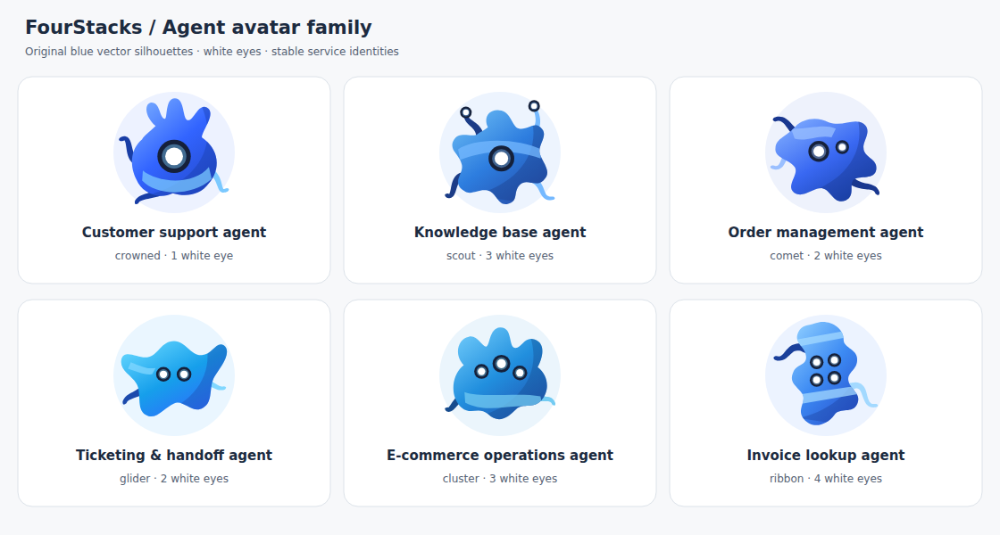

# FourStacks agent avatar guide

The six avatars below are exported from the existing landing-page profiles. Their silhouettes, blue gradients, markings, tapered tendrils and white eyes are the identity system for the implemented agents.



## Identity mapping

Use stable service IDs. The legacy numeric `artKind` selects artwork only; it is not an entitlement, backend capability ID or runtime state.

| Preview                                                                               | Service ID  | Product name                | Shape / white eyes               | `artKind` |
| ------------------------------------------------------------------------------------- | ----------- | --------------------------- | -------------------------------- | --------- |
|        | `support`   | Customer support agent      | Crowned / 1                      | 1         |
|      | `knowledge` | Knowledge base agent        | Scout / 3, including 2 on stalks | 5         |
|             | `orders`    | Order management agent      | Comet / 2, unequal sizes         | 3         |
|       | `tickets`   | Ticketing & handoff agent   | Glider / 2                       | 0         |
|  | `ecommerce` | E-commerce operations agent | Cluster / 3                      | 2         |
|        | `invoices`  | Invoice lookup agent        | Ribbon / 4                       | 4         |

The scout represents the implemented knowledge base in the current product catalog. The glider represents ticketing and handoff. Earlier landing-page iterations used these shapes for other roles; use this current mapping in the product.

## Canonical palette

| ID          | Main      | Shade     | Accent    | Backdrop  | Gradient stops                  |
| ----------- | --------- | --------- | --------- | --------- | ------------------------------- |
| `support`   | `#3264FF` | `#183DA5` | `#7BC9FF` | `#EDF2FF` | `#78ACFF`, `#3264FF`, `#2349CA` |
| `knowledge` | `#2466C1` | `#1B3C87` | `#75B9FF` | `#EDF4FE` | `#6ABBF4`, `#2D7DDF`, `#244BA7` |
| `orders`    | `#2457E5` | `#19378F` | `#9ABFFF` | `#EEF2FC` | `#80ADFF`, `#3968F2`, `#153EA7` |
| `tickets`   | `#0875CA` | `#1C4AAC` | `#81D7FF` | `#EAF6FF` | `#67D8FF`, `#169FEB`, `#3264FF` |
| `ecommerce` | `#126BB3` | `#164B8D` | `#73CBF2` | `#EBF5FC` | `#6FCAFA`, `#218FDE`, `#2253B1` |
| `invoices`  | `#2D64D9` | `#193F9B` | `#A3D9FF` | `#ECF3FF` | `#8ACBFF`, `#3C8AF3`, `#2850CE` |

Eyes use a dark `#15203A` well, a subtle blue halo and a white `#FFFFFF` iris. Keep the iris white when tracking the pointer. Do not add a dark pupil, a mouth or facial accessories.

## Assets

- `assets/agents/<service-id>.svg`: portable body-only avatar, transparent background, no workstation, no animation.
- `assets/agents/<service-id>-working.svg`: still export of the actual agent and its workstation, transparent background.
- [manifest.json](assets/agents/manifest.json): exact filenames, service mappings, shape names, eye counts and colors.
- [agent-avatar-sheet.svg](assets/agent-avatar-sheet.svg): full family as vector artwork.
- [fourstacks-mark.svg](assets/fourstacks-mark.svg): original four-layer mark for light surfaces.

The body-only export has a padded `-8 -8 176 176` viewBox. The working export uses `-32 -8 224 208` so hands and props have room. Keep those viewBoxes and preserve aspect ratio. The exports have self-contained gradients and clipping paths and need no external fonts, images or CSS.

## Size and composition

| Display size | Where                                  | Treatment                                                |
| ------------ | -------------------------------------- | -------------------------------------------------------- |
| 24–32 px     | Compact attribution / dense navigation | Still body-only asset; verify white eyes remain readable |
| 40–48 px     | List rows and detail headers           | Still body-only asset                                    |
| 64–96 px     | Agent cards and onboarding             | Still body-only asset on white or its own pale backdrop  |
| 160–224 px   | Selected-agent details                 | Working illustration; optional restrained motion         |

Use a Lucide product icon instead if a 16 px slot makes the character illegible. Do not squeeze a workstation into a 32 px avatar. Keep the character's entire silhouette visible rather than cropping it into a face-only circle.

Status belongs in a separate text badge. A blue body is an identity, not proof of being online. Keep planned services marked `Planned` with a product icon until a new, distinct character is designed and approved.

## Static React example

Copy `assets/agents/*.svg` into your product's `public/fourstacks/agents/`, then copy [AgentAvatar.tsx](examples/AgentAvatar.tsx) into your component library and import [fourstacks-tokens.css](fourstacks-tokens.css).

```tsx
import AgentAvatar from './AgentAvatar'

export function KnowledgeIdentity() {
  return (
    <div className="agent-identity">
      <AgentAvatar agentId="knowledge" size={48} />
      <div>
        <strong>Knowledge base</strong>
        <span>Source-backed business answers</span>
      </div>
    </div>
  )
}
```

The default empty `alt` avoids announcing the same name twice when text is adjacent. When an image alone communicates identity, supply `label="Knowledge base agent"`. If the whole row is a link or button, give that control an accessible name and keep the image decorative.

The `assetBase` prop supports a different deployment path. Keep the six service IDs in one shared mapping; do not select avatars by a filtered list's array position.

## Animated working example

 

[WorkingAgentAvatar.tsx](examples/WorkingAgentAvatar.tsx) wraps the existing SVG engine. The bundle includes its six source modules in `examples/agent-engine/`. Copy the wrapper, `AgentAvatar.tsx` (for its shared types) and that folder together into the product repository:

```text
BlobAgent.tsx
AgentFace.tsx
AgentWorkstation.tsx
agentWork.ts
agentDeformation.ts
useAgentGaze.ts
```

These modules are generated copies of the canonical landing-page source; update the original source and rerun the exporter to refresh them. The only external runtime dependency of this illustration engine is React. Retain the SVG IDs generated by `useId`, geometry and shared work clock. Use the namespaced avatar styles in `fourstacks-tokens.css` rather than copying all landing-page CSS.

```tsx
import WorkingAgentAvatar from './WorkingAgentAvatar'

// Supply a real product preference and selected-agent visibility.
;<WorkingAgentAvatar
  agentId="support"
  size={192}
  paused={motionPaused || !isSelectedAgentVisible}
  label="Customer support agent illustration"
/>
```

The wrapper defaults to `paused={true}`. Opt in deliberately in the detail view. The underlying engine honors reduced motion, hidden documents and its own visibility observer. Compact avatars remain still.

Working gestures are illustrative: the support agent types, knowledge agent reviews sources, ticketing agent routes requests, marketplace agent uses catalog controls, order agent handles a parcel and invoice agent writes review marks. These gestures must not be presented as live backend actions. In particular, an invoice character holding a pen does not mean invoice creation or LHDN submission is implemented.

For a real running job, display server-provided state and progress beside the illustration. Do not derive completion, task counts, approval decisions or connection state from an animation timer.

## Extending the family

For each new service, define its stable service ID, distinct body silhouette, eye arrangement, blue palette and work gesture. Preserve a malleable body, tapered flexible hands and white eyes. Keep props role-appropriate and connected to hands through the same clock. Design at full detail size, then review at 32, 48 and 96 px.

If no approved avatar exists, show the service's product icon and name. Do not duplicate an existing character and present it as a new specialist.

## Regenerate and verify

From the workspace root, with the landing page's dependencies installed:

```sh
node ui-guide/scripts/export-avatars.mjs
```

The exporter uses the existing local esbuild tooling, React server rendering and the canonical source profiles. It generates the SVG assets, manifest, mark and family sheet and copies the six animation modules into the handoff examples. The PNG reference is a browser-rendered copy of the sheet and should be refreshed after changing the artwork.

Review all six images at small sizes; ensure no hands or eye stalks are clipped. Check white eyes, the service mapping and unique gradient/clip IDs when SVGs are embedded inline. When using ``, each file has its own SVG ID scope.
